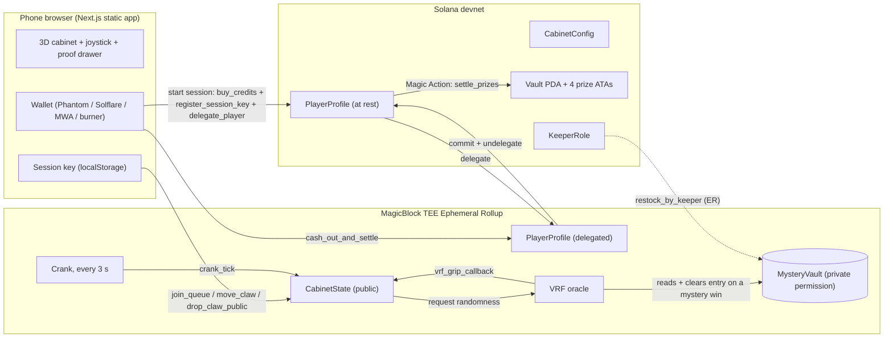
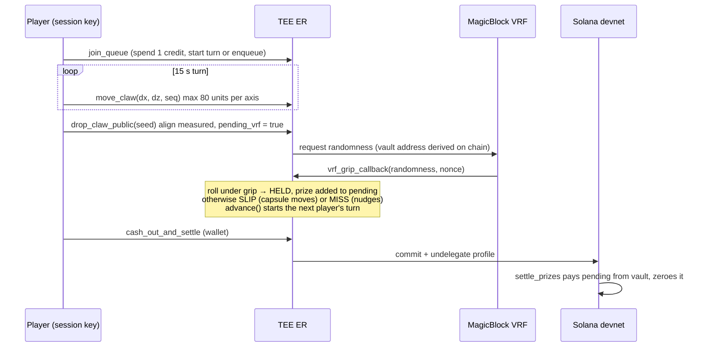

# ClawRush architecture (as built)

This file describes the deployed program `9UwwBZu55wdbjQm3LdDKLHck79Sr95EPZsS5zRuvkKNs` and the app at
https://clawrush.pages.dev. Everything here was read from the code. [docs/03-ARCHITECTURE.md](docs/03-ARCHITECTURE.md)
is the original design: it has the grip formula and the invariant list, but its account section predates the build.
Trade-offs: [docs/DECISIONS.md](docs/DECISIONS.md).

## MagicBlock primitives used

| Primitive | Used for | Code |
|---|---|---|
| Ephemeral Rollup on the **TEE validator** | Cabinet state, mystery vault and player profiles are delegated. Queue, moves, drops, turn hand-off and restock all run on the ER | `delegate_cabinet`, `delegate_player` (`#[delegate]`, `del` accounts); `#[ephemeral]` on the program |
| **VRF** (ephemeral queue) | Grip roll, slip distance, miss nudges | `drop_core` → `create_request_randomness_ix_const`; callback `vrf_grip_callback` |
| **Private ER** (permission program) | The mystery vault gets a private permission with zero members | `seal_mystery` → `CreateEphemeralPermissionCpi` |
| **Commit + undelegate** | Profile goes back to Solana on cash-out | `cash_out`, `cash_out_and_settle` (`MagicIntentBundleBuilder::commit_and_undelegate`) |
| **Magic Action** | Post-undelegate payout of every pending prize on L1 | `cash_out_and_settle` → `add_post_undelegate_actions` → `settle_prizes` (`#[action]`) |
| **Crank** (ER scheduler) | Ends overdue turns every 3 s | `schedule_crank` (`ScheduleCrankCpi`) → `crank_tick` |
| **TEE auth token** | Every sending client gets a token from a signed challenge | `getAuthToken` in `app/src/lib/chain.ts` (`erFor`), `scripts/lib/common.ts`, `tests/invariants.ts` |

Not used: **Magic Router** (clients open two direct connections, see below) and **MagicBlock Session Keys**
(ClawRush stores its own scoped key in the profile, decision 5).

## Endpoints and program IDs

| What | Value | Where set |
|---|---|---|
| Solana L1 RPC | `https://api.devnet.solana.com` | `NEXT_PUBLIC_BASE_URL` (app), `BASE_URL` (scripts) |
| MagicBlock TEE ER RPC / WS | `https://devnet-tee.magicblock.app` / `wss://devnet-tee.magicblock.app` | `NEXT_PUBLIC_ER_URL` (app), `ER_URL` (scripts) |
| TEE validator identity | `MTEWGuqxUpYZGFJQcp8tLN7x5v9BSeoFHYWQQ3n3xzo` | `config.validator` on chain; `ER_VALIDATOR` (scripts) |
| VRF ephemeral queue | `5hBR571xnXppuCPveTrctfTU7tJLSN94nq7kv7FRK5Tc` | `app/src/lib/chain.ts`, `scripts/lib/common.ts`; the program accepts only the SDK's default queues |
| Permission program | `ACLseoPoyC3cBqoUtkbjZ4aDrkurZW86v19pXz2XQnp1` | `scripts/lib/common.ts` |
| Delegation program | `DELeGGvXpWV2fqJUhqcF5ZSYMS4JTLjteaAMARRSaeSh` | `scripts/lib/common.ts` |
| Magic program / context | `Magic11111111111111111111111111111111111111` / `MagicContext1111111111111111111111111111111` | `app/src/lib/chain.ts` |

Reads of the public cabinet need no token. Sends go to `ER_URL?token=…`: the session key signs the TEE login
locally, so play has no popup, and the wallet signs one login message at cash-out. ER explorer links use
`cluster=custom&customUrl=https://devnet-tee.magicblock.app`.

## SDK and toolchain versions (from Cargo.toml, Cargo.lock, package.json)

| Package | Version |
|---|---|
| `anchor-lang`, `anchor-spl` | `=1.0.2` (anchor-cli 1.2.1 in `Anchor.toml`) |
| `ephemeral-rollups-sdk` (Rust) | `=0.18.0`, features `anchor, vrf, access-control, crank` |
| `ephemeral-vrf-sdk` | 0.18.0 (transitive, via `ephemeral-rollups-sdk`) |
| `magicblock-delegation-program-api` / `magicblock-magic-program-api` | 3.1.0 / 0.10.1 (transitive) |
| `@magicblock-labs/ephemeral-rollups-sdk` (npm, root + app) | 0.18.0 |
| `@coral-xyz/anchor` / `@solana/web3.js` / `@solana/spl-token` | 0.32.1 / 1.98.4 / 0.4.14 |
| App | Next.js 15.5.29, React 19.1.0, three ^0.187.0, Tailwind 4, wallet-adapter-react 0.15.40, `@solana-mobile/wallet-standard-mobile` 0.7.1 |

Why these pins (e.g. 0.20's `#[vrf]` macro did not compile with anchor 1.0.2): [docs/DECISIONS.md](docs/DECISIONS.md#toolchain-pinned).

## System diagram

## Accounts (`programs/clawrush/src/state.rs`)

| Account | Seeds | Lives on | Key fields |
|---|---|---|---|
| `CabinetConfig` | `["config", cabinet_id]` | L1 (read on the ER) | `authority`, `validator`, `play_price`, `turn_secs`, `grip_max_bps`, `grip_min_bps`, `max_payout_per_round[4]`, `restock_threshold`, `mints[4]`, `total_claimed[4]` |
| `CabinetState` | `["cabinet", cabinet_id]` | delegated to the ER, public | claw `x/z`, `capsules[12]`, `queue[16]` ring buffer (`q_head`, `q_len`), `turn_owner`, `turn_expires_at`, `round`, `pending_vrf`, `vrf_nonce`, `drop_at`, `drop_capsule`, `drop_align_bps`, `total_won[4]`, counters, `last: LastResult`, `recent_wins[5]` |
| `MysteryVault` | `["mystery", cabinet_id]` | delegated to the ER, private permission | `sealed`, `entries[12]` of `MysteryEntry { set, mint_idx, amount, tier }` |
| `PlayerProfile` | `["player", cabinet_id, wallet]` | L1 at rest, delegated while playing | `credits`, `plays`, `wins`, `session_key`, `session_expires_at`, `in_queue`, `pending[4]`, `faucet_last`, `last_round` |
| `KeeperRole` | `["keeper", cabinet_id]` | L1 (read by the ER) | `keeper` |
| Vault authority | `["vault", cabinet_id]` | L1, no data | owns the 4 prize ATAs (dUSDC, dGEM, KOI, ROBO) |
| Faucet authority | `["faucet"]` | L1, no data | mint authority of demo dUSDC |
| Permission | permission program PDA of the mystery vault | ER | zero members, `is_private: true` |

`Capsule { id, x, z, radius, active, kind (0 token / 1 collectible / 2 mystery), mint_idx, amount, slip_count }`.
For mystery capsules, `mint_idx` and `amount` are always 0 in the public account.

Constants (`constants.rs`): grid 0–1000, chute at (900, 900) with keep-out 90, `MAX_STEP` 80, radius 30–120,
`VRF_TIMEOUT_SECS` 30, `MAX_SESSION_SECS` 24 h, `MAX_CREDITS_PER_BUY` 50, faucet 20 dUSDC per hour. They are
mirrored in `scripts/lib/math.ts` and `app/src/lib/math.ts`.

## Instructions (`programs/clawrush/src/lib.rs`)

"Session" = the scoped session key may sign it.

| Instruction | Layer | Signer | Does | Main errors |
|---|---|---|---|---|
| `init_cabinet` | L1 | authority | Create config, cabinet state, mystery vault | `InvalidParams` |
| `delegate_cabinet` | L1 | authority | Delegate cabinet + mystery vault to `config.validator` | `ConstraintHasOne` |
| `seal_mystery` | ER | authority | Private zero-member permission on the vault (idempotent) | |
| `restock` | ER | authority | `restock_core`: bounds, payout cap, per-mint solvency | `NotSealed`, `InvalidCapsule`, `PayoutTooLarge`, `NoFreeSlot`, `VaultInsolvent` |
| `set_keeper` | L1 | authority | Store a keeper key in `KeeperRole` | `ConstraintHasOne` |
| `restock_by_keeper` | ER | keeper | Same `restock_core` | `Unauthorized` + the restock errors |
| `admin_undelegate` | ER | authority | Recovery: close the permission, commit the vault (makes contents public) | |
| `init_player` | L1 | player | Create the per-cabinet profile | |
| `faucet` | L1 | player | 20 demo dUSDC, once per hour | `FaucetCooldown` |
| `buy_credits(n)` | L1 | player | Pay `play_price × n` into the vault | `InvalidParams` |
| `register_session_key(key, expires_at)` | L1 | player | Scoped key, ≤ 24 h | `SessionTooLong` |
| `delegate_player` | L1 | player | Delegate the profile to the ER | |
| `join_queue` | ER | player / session | Spend 1 credit; start the turn if idle, else enqueue | `NoCredits`, `AlreadyQueued`, `QueueFull`, `SessionKeyNotAllowed`, `SessionExpired` |
| `move_claw(dx, dz, seq)` | ER | turn owner / session | Clamp to `MAX_STEP` and the grid | `NotYourTurn`, `TurnExpired`, `VrfPending` |
| `drop_claw_public(seed)` | ER | turn owner / session | Measure alignment, request VRF; vault address derived on chain (tx readable) | `NotYourTurn`, `TurnExpired`, `VrfPending` |
| `drop_claw(seed)` | ER | turn owner / session | Older variant that lists the vault (TEE redacts the tx) | same |
| `vrf_grip_callback(randomness, nonce)` | ER | VRF identity only | HELD / SLIP / MISS, mystery reveal, credit `pending`, next turn | `Unauthorized`, `NoVrfPending`, `StaleVrfCallback` |
| `expire_turn` | ER | anyone | End an overdue turn; refund if the VRF is stuck > 30 s | `TurnNotExpired`, `VrfPending` |
| `schedule_crank(interval_ms, iterations)` | ER | authority | Schedule `crank_tick` | `InvalidParams` |
| `crank_tick` | ER | scheduler (permissionless) | End an overdue turn; no-op otherwise | |
| `cash_out_and_settle` | ER | wallet | Commit + undelegate + post-undelegate `settle_prizes` | `StillQueued` |
| `settle_prizes` | L1 | delegation program escrow | Pay all `pending`, zero it | `Unauthorized` |
| `cash_out` / `claim_prize(mint_idx)` | ER / L1 | wallet | Fallback: commit + undelegate, then claim one mint | `StillQueued`, `NothingToClaim` |

Events (`events.rs`): `QueueJoined`, `TurnStarted`, `ClawMoved`, `DropInitiated`, `GripResolved`, `CapsuleSlipped`,
`CapsuleWon`, `MysteryRevealed`, `PrizeSettled`, `TurnExpired`, `CabinetRestocked`, `KeeperSet`.

## Grip math (`programs/clawrush/src/math.rs`)

Integer and basis points only. Formula and rationale: [docs/03-ARCHITECTURE.md](docs/03-ARCHITECTURE.md#grip-math-all-integer--bps--lives-in-mathrs).

- Measured at **drop** (`drop_core`): `nearest` active capsule, `align_err_bps`. Stored in `drop_align_bps`.
- Resolved in the **callback**: `grip_bps(align, grip_max, grip_min)`, `roll_bps(randomness, 0)`, `outcome`.
  HELD pays, SLIP calls `slip_toward_chute(x, z, slip_frac_bps)` (15–65% of the way, outside the keep-out), MISS
  calls `nudge_targets` (≤ 2 capsules within 1.5 radius, ±`NUDGE_MAX`).
- The app runs the same math (`app/src/lib/math.ts`) for the predicted-grip meter and the proof-drawer re-check.
  Neither decides anything.

## Privacy

- The mystery vault has a private permission with no members. `getAccountInfo` returns `null` with no token, a
  stranger's token and the authority's token (invariant 7).
- Any transaction that lists the vault comes back from the TEE as an empty stub: restock, the old `drop_claw`, and
  callbacks (decisions 14, 17). `drop_claw_public` keeps the drop readable by deriving the vault address inside the
  program.
- Mystery contents are drawn with `crypto.randomInt` at restock (`scripts/lib/stock.ts`, `drawMystery`) and are
  never written to disk. The tier table is public; which capsule holds which tier is not.

## Settlement

A win only adds to `profile.pending` on the ER. `cash_out_and_settle` exits the profile, then calls
`commit_and_undelegate` and adds a post-undelegate `CallHandler` to `settle_prizes`. A post-*commit* action would
run while the delegation program still owns the profile (decision 22). `settle_prizes` checks
`source_program == crate::ID`, `escrow_auth == profile.authority`, and that `escrow` is the signer at
`ephemeral_balance_pda_from_payer(escrow_auth, 255)`. If the action fails, the commit still lands and `claim_prize`
pays later. Both paths zero `pending`.

## Off-chain parts

| Part | What it does | Trust |
|---|---|---|
| `app/` | Static Next.js export. Reads chain, builds txs, three.js cabinet with a 2D canvas fallback | Presentation only; outcomes come from chain |
| `scripts/keeper.ts` | Restocks below `MIN_ACTIVE` (authority or keeper key) | Restock is bounded by `restock_core` |
| `.github/workflows/keeper.yml` | Runs one keeper pass every 10 min with `KEEPER_KEYPAIR` | Keeper key can only restock |
| `scripts/crank.ts` | Schedules / ticks / watches the ER crank | `crank_tick` is idempotent |
