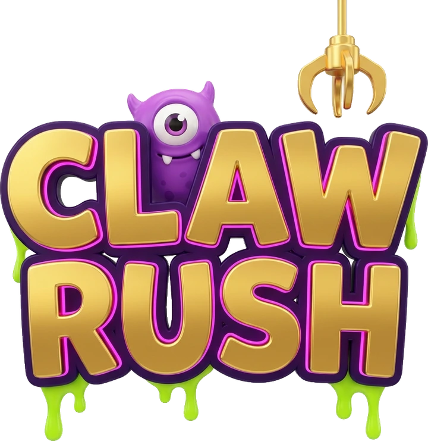
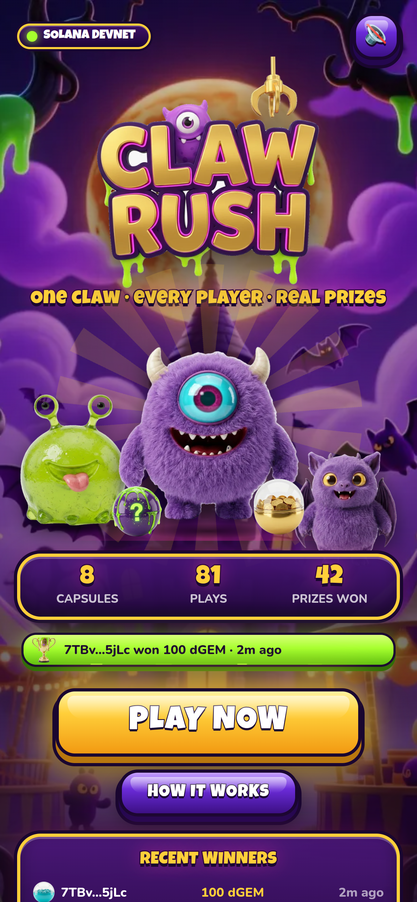
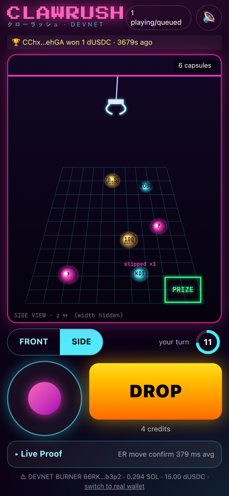
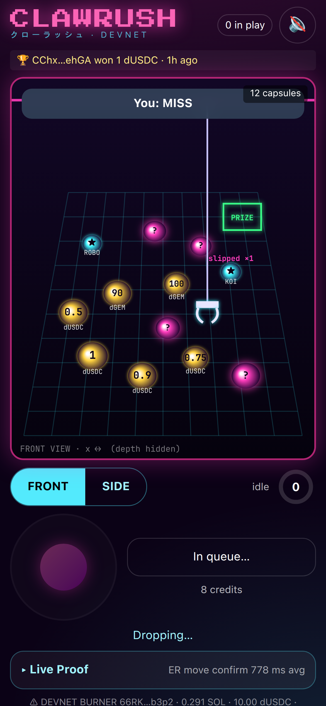
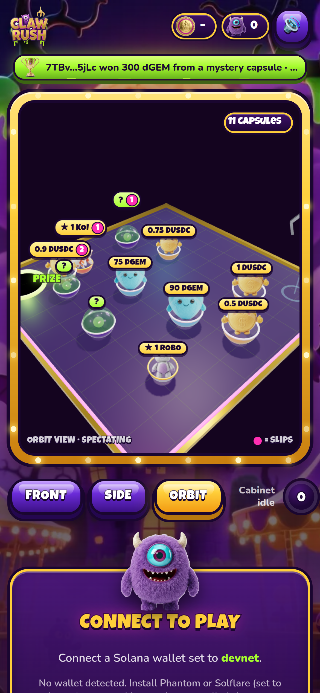
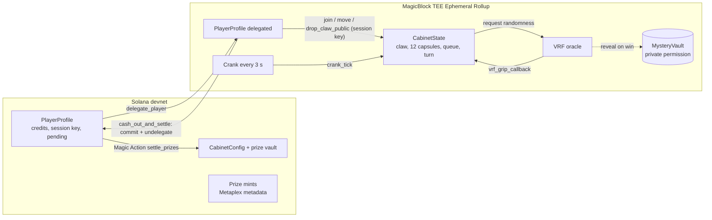
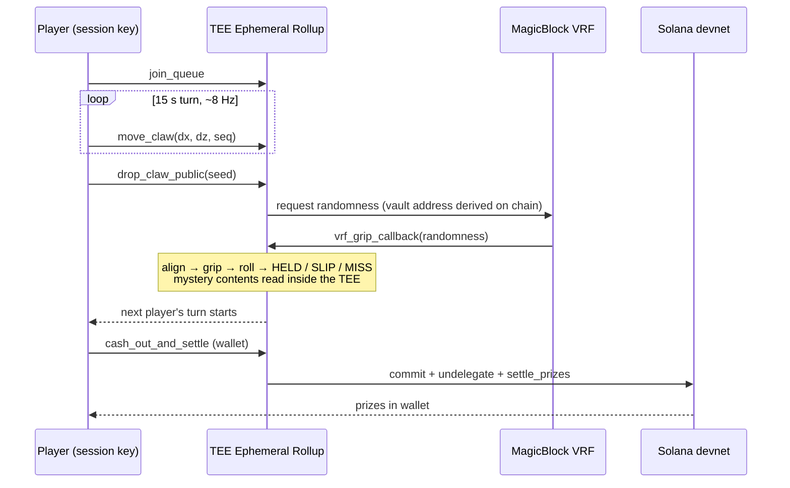

<p align="center">
  
</p>

<h1 align="center">ClawRush</h1>

<p align="center"><b>One claw, every player, real prizes.</b><br>
A live multiplayer claw machine you play from your phone, on Solana + MagicBlock.</p>

<p align="center">
  <a href="https://clawrush.pages.dev"></a>
  
  
  
  
</p>

<p align="center">
  
  
  
  
  
</p>

Built for **MagicBlock Solana Blitz v10 · Entertainment Finance**, answering MagicBlock's own prompt:
*"An arcade claw you play from your phone, stocked with collectibles and tokens instead of plush toys."*

Everyone plays **the same cabinet** in real time. Capsules **stay where they land**. Your **aim sets your grip
chance** before MagicBlock VRF rolls it. Jackpot **mystery capsules are sealed** in a TEE-backed Private Ephemeral
Rollup so bots can't read them. Wins pay devnet tokens and collectibles to your wallet in **one signature**.

> Everything runs on **Solana devnet** and the **MagicBlock devnet TEE validator**. Prize tokens are demo tokens with
> no value. Every number and link in this README comes from a real devnet run.

---

## Contents

- [Play](#play)
- [What makes it different](#what-makes-it-different)
- [How MagicBlock powers it](#how-magicblock-powers-it)
- [Architecture](#architecture)
- [Grip math](#grip-math)
- [Economics and solvency](#economics-and-solvency)
- [Security model](#security-model)
- [On-chain proof](#on-chain-proof-devnet)
- [Run it yourself](#run-it-yourself)
- [Repository layout](#repository-layout)
- [What's next](#whats-next)

## Play

**https://clawrush.pages.dev** — phone, portrait.

1. **Connect** a devnet wallet: Phantom, Solflare, or Mobile Wallet Adapter on Android. An opt-in, clearly labelled
   **devnet burner** wallet (stored only in your browser) is there for a quick look. The burner path is tested
   end-to-end in a browser; the Phantom / Solflare / MWA path is built but **not yet tested on a real device**.
   You need a little devnet SOL for fees (https://faucet.solana.com).
2. **Start session** — one approval buys credits (free demo dUSDC from the on-chain faucet in the same transaction),
   registers a scoped session key, and moves your profile onto the Ephemeral Rollup.
3. **Insert credit** to join the shared queue. On your 15 s turn: steer with the joystick, flip **FRONT / SIDE** to
   judge depth, then **DROP**. No wallet popups while you play. Waiting? Watch in **ORBIT** view.
4. **Cash out** — one approval commits your profile back to Solana and a Magic Action pays every prize to your wallet.

### On the phone

- **Real-time 3D cabinet** (three.js). Capsules sit at their exact on-chain grid coordinates and radius, so what you
  aim at is what the program measures. Two axis-aligned aiming cameras plus a spectator-only **orbit** camera; a 2D
  canvas fallback when WebGL is unavailable. Prizes are plush characters with Metaplex metadata in your wallet.
- **Live predicted-grip meter** — the app runs the program's own integer math (ported 1:1 in
  `app/src/lib/math.ts`, curve read from the on-chain `CabinetConfig`) and shows *GRIP 78% · predicted* while you aim.
- **In-browser fairness re-check** — the Live Proof drawer recomputes every drop from the on-chain record
  (alignment → grip → roll &lt; grip ⇒ HELD) and shows ✓ when it matches. Every move, drop and payout has an
  explorer link.
- **Win ticker and leaderboard** from the cabinet's on-chain `recent_wins` ring buffer; turn timer and queue length
  read from chain.
- Sound, haptics and character animation are presentation only. None of it decides outcomes.

## What makes it different

| | Typical on-chain claw | **ClawRush** |
|---|---|---|
| Does skill matter? | No — the claw is a show, RNG decides | **Aim × VRF**: 85% grip dead centre → 25% at the edge |
| Players per cabinet | One, isolated | **One shared live cabinet**, queue + 15 s turns, spectators |
| Persistent world | Fresh box each play | **Capsules stay where they land**; slips move them toward the chute |
| Hidden prizes | Readable on chain | **Mystery capsules sealed in a Private ER**, unreadable even with an RPC token |
| Payout | Separate claim transaction | **One signature**: commit + undelegate + Magic Action payout |
| Idle players | Block the machine | **On-chain crank** clears overdue turns every 3 s, no server |
| Fairness proof | "Trust the VRF" | VRF + predicted grip + in-browser re-check + Monte Carlo + 23 devnet invariant checks |

## How MagicBlock powers it

Every primitive is load-bearing: remove one and the game breaks. Only what is integrated **and exercised on devnet**
is listed.

| Primitive | Used for | Without it |
|---|---|---|
| **Ephemeral Rollup** (TEE validator, `devnet-tee.magicblock.app`) | The cabinet and player profiles are delegated; queue, every claw move, drop and turn hand-off run there. Move confirmations ~380–780 ms from a browser. | L1 is too slow for a joystick; every move would cost a fee and a popup. |
| **VRF** (ephemeral queue) | `drop_claw_public` requests randomness; `vrf_grip_callback` rolls grip, slip distance and miss nudges. Median callback 205 ms after the drop confirmed (30 devnet rounds). | The operator or validator could pick winners. |
| **Private ER** (permission program) | `seal_mystery` puts a zero-member permission on the mystery vault. The TEE RPC returns `null` for it to everyone. The drop derives the vault address on chain instead of listing it, so the drop itself stays publicly readable while the vault does not. | Bots read which `?` capsule holds the jackpot and snipe it. |
| **Commit + undelegate + Magic Action** | `cash_out_and_settle` commits and undelegates the profile and attaches a post-undelegate action, `settle_prizes`, that pays every pending prize from the L1 vault in the same settlement. `claim_prize` stays as fallback; both zero `pending` as they pay. | Prizes stuck in the rollup, or a second transaction + popup. |
| **Crank** (ER scheduled task) | `crank_tick` runs every 3 s on the ER scheduler, ends overdue turns and hands the claw to the next in line. Idempotent; no server. | One idle player blocks the shared cabinet. |

ClawRush registers its own scoped session key in the player profile instead of MagicBlock Session Keys
(see [Security model](#security-model)).

**Operator side.** Restock writes the private vault, so it can't come from the crank. A separate low-privilege
**keeper role** (`set_keeper` / `restock_by_keeper`) may only restock, through the same solvency checks; it never holds
the cabinet authority (which is also the upgrade key). A [GitHub Actions job](.github/workflows/keeper.yml) runs one
keeper pass every 10 minutes once the `KEEPER_KEYPAIR` secret is set.

## Architecture





Full design: [`docs/03-ARCHITECTURE.md`](docs/03-ARCHITECTURE.md). Every trade-off: [`docs/DECISIONS.md`](docs/DECISIONS.md).

## Grip math

Integer only, `programs/clawrush/src/math.rs`:

```
nearest capsule c to the claw (x, z), d = isqrt(dx² + dz²)
align_err_bps = min(10_000, d · 10_000 / c.radius)         ≥ 10_000 → MISS
grip_bps      = grip_max − (grip_max − grip_min) · align_err_bps / 10_000      85% centre → 25% edge
roll_bps      = u16(randomness[0..2]) % 10_000
roll < grip   → HELD: prize to pending, capsule removed
otherwise     → SLIP: capsule slides toward the chute by u16(randomness[2..4]) % 10_000 of the way
MISS          → up to 2 nearby capsules nudged by randomness[4..8]
```

Basis points and integer grid units (0–1000) throughout. Unit-tested in Rust and ported to TypeScript
(`scripts/lib/math.ts`) with the same test vectors.

## Economics and solvency

Monte Carlo over the same integer math (`scripts/ev_simulation.ts`, 100,000 turns per population; full table in
[`scripts/ev_results.md`](scripts/ev_results.md)):

| Player | Return to player | HELD | SLIP | MISS |
|---|---|---|---|---|
| Beginner (random target, sloppy aim) | 33.0% | 36.5% | 38.4% | 25.1% |
| Skilled | 78.0% | 77.7% | 22.3% | 0.0% |
| Perfect aim-bot | 86.2% | 86.3% | 13.7% | 0.0% |

Skill raises returns, but even a perfect bot stays below 100%: visible prizes are capped near one play and jackpots
live only in sealed mystery capsules. On chain, every restock is rejected if the vault can't cover it
(`VaultInsolvent`); in simulation the vault never fell below its live liability.

## Security model

- **Session key scope.** `register_session_key` (wallet-signed, ≤ 24 h) stores one key, accepted only by `join_queue`,
  `move_claw`, `drop_claw` / `drop_claw_public`. Everything else derives the profile from the signing wallet.
- **Per-cabinet profiles** (`["player", cabinet_id, wallet]`): a prize from one cabinet can't be claimed from another.
- **VRF**: only the VRF program identity can sign the callback; `pending_vrf` + a per-drop nonce allow exactly one
  callback per drop; a stuck VRF is cancelled after 30 s and the credit refunded.
- **Magic Action**: `settle_prizes` requires the delegation program's escrow signature, so it can't be called directly.
- **Keeper role**: can restock only, under the same bounds and solvency checks; only the cabinet authority can set it.

The 7 invariants from [`docs/03-ARCHITECTURE.md`](docs/03-ARCHITECTURE.md) run as **real devnet / TEE transactions**
on a separate test cabinet: [`tests/invariants.ts`](tests/invariants.ts) → [`docs/INVARIANTS.md`](docs/INVARIANTS.md),
**23/23 checks pass**.

| # | Invariant | Tested by (expected rejection) |
|---|---|---|
| 1 | Only the turn owner or their session key can move / drop | other player's key → `NotYourTurn`; unregistered key → `SessionKeyNotAllowed`; expired → `SessionExpired` |
| 2 | Session key can't buy, claim, cash out, restock | `ConstraintSeeds` ×3, `ConstraintHasOne`; session > 24 h → `SessionTooLong` |
| 3 | Only the VRF identity can call back; one callback per drop | forged callback → `Unauthorized` |
| 4 | `expire_turn` works for anyone after expiry, never before | early → `TurnNotExpired` |
| 5 | Restock can't break solvency | over-stock → `VaultInsolvent` |
| 6 | A prize is paid exactly once | claim while delegated → rejected; second claim → `NothingToClaim`; cross-cabinet → `ConstraintSeeds` |
| 7 | Mystery vault unreadable | `getAccountInfo` → `null` with no token, a stranger's token and the authority's token |

More devnet end-to-end suites, each printing explorer links:

| Script | Proves |
|---|---|
| [`scripts/e2e_magic_action.ts`](scripts/e2e_magic_action.ts) | Win → one ER transaction → wallet receives exactly `pending`; later `claim_prize` → `NothingToClaim`; direct `settle_prizes` rejected |
| [`scripts/e2e_crank.ts`](scripts/e2e_crank.ts) | An idle turn is cleared by `crank_tick` with no keeper running |
| [`scripts/e2e_public_drop.ts`](scripts/e2e_public_drop.ts) | Public drop resolves via VRF and is readable with no token; vault stays unreadable; a mystery win is revealed and credited; strangers can't restock or set the keeper |
| [`scripts/e2e_two_player.ts`](scripts/e2e_two_player.ts) | Shared queue: B queues during A's turn and plays next ([8/8](docs/E2E_TWO_PLAYER.md)) |

## On-chain proof (devnet)

ER links open Solana Explorer pointed at the TEE RPC.

| Item | Link |
|---|---|
| Program | [`9UwwBZu5…`](https://explorer.solana.com/address/9UwwBZu55wdbjQm3LdDKLHck79Sr95EPZsS5zRuvkKNs?cluster=devnet) · [latest upgrade](https://explorer.solana.com/tx/54X1UbEgZ5N8PgFbvGtXULtA9URK4NhUk6kvyHn4JXATLTNvaCkGEFWu2kvYPSBmGWGDokW1fuURBi89u2eB9buw?cluster=devnet) |
| Cabinet config (L1) | [`CLaFhSGw…`](https://explorer.solana.com/address/CLaFhSGwWV96RqhR49LoWyxfrJo9e7jQGbeDWTdckWDv?cluster=devnet) · [init_cabinet](https://explorer.solana.com/tx/4nAPxqpwKGe27hHYs7qgHnV5Cb4apEjhhFD1K3zsuqLJqbsLurNfjZ7MX31D8PAiysj9gMszQwtGU5PBadF1A7CB?cluster=devnet) |
| Cabinet state (on the TEE ER) | [`EUK77P9z…`](https://explorer.solana.com/address/EUK77P9zFtQDdivoMEcktcGfs9wHPdyydbtiG1P62w5S?cluster=custom&customUrl=https%3A%2F%2Fdevnet-tee.magicblock.app) · [delegate_cabinet](https://explorer.solana.com/tx/2FzY9oJrQXab58GSnLmjZ6ShPzQnAnvi4zkzxRKjLLSkd4LGGMqU4vX2WctvvKXxmZyXv5dgELXfNk1cHpWN2G7v?cluster=devnet) |
| Prize vault | [`7FYk2SBg…`](https://explorer.solana.com/address/7FYk2SBgXR3uM7YtdP5Kg9qMF1D1T5zKF8QFGvRMojf2?cluster=devnet) |
| Session start | [buy_credits](https://explorer.solana.com/tx/2MWZDtPEuU1xN4YQQSNn7rTVGFDFVxuQaaVfuKniQtC99K4i2Q9hBvrkp5mHtaQ51qWW2MYrirqJtYNaX1AcjxJJ?cluster=devnet) · [register_session_key](https://explorer.solana.com/tx/2XfZwLabdThUYDed5gu8oSkBLYBDsxhD52x7JTq2ze5c8sDwDKCK24rrWkxCd5tun5yFUtJQHCBJr3GvqpFTW9UX?cluster=devnet) · [delegate_player](https://explorer.solana.com/tx/3WZTo93oLX9EkRG9KZgAFrcsgmwbXuU96XVrbJAZ8JQVV198Anq6jEtaoEHH2T77EXQwUw2fvQQtkkn3NpkXMKVB?cluster=devnet) |
| Queue + moves (ER) | [join_queue](https://explorer.solana.com/tx/5YVKpXCc7WBBCbv5uZmTRqRBjrmahPtdxkY3aqK8nbKcrHe3Z7BHfvhvXR33MQ1pApQmwgASPZxhVinESN7PsreH?cluster=custom&customUrl=https%3A%2F%2Fdevnet-tee.magicblock.app) · [move_claw](https://explorer.solana.com/tx/5bjqZesyUdyan4CPhKdt9gRFCTb8DbpzTh6bKSNnTpqtREKbcghidCi3rbk3f6yRQdm7TrNBb3tQyze71peA9cQr?cluster=custom&customUrl=https%3A%2F%2Fdevnet-tee.magicblock.app) |
| Public drop → VRF request (ER) | [drop_claw_public](https://explorer.solana.com/tx/mgkuyDCPb4k85BBQ1xwRgSaETtoVZGEQZzLhJJtFLZpUCZPRiCid2K1UmJRSTELdmMetTt7xCDNu1qi8nmR5fdj?cluster=custom&customUrl=https%3A%2F%2Fdevnet-tee.magicblock.app) — fully readable, no token needed |
| VRF callback / mystery reveal | Not a public link: callbacks write the sealed vault, so the TEE redacts them (the privacy guarantee working). The result is public in the cabinet's `last` field and in the app's proof drawer. |
| Crank clearing an idle turn (ER) | [crank_tick](https://explorer.solana.com/tx/31BH7Arp96NU5xS8BDrEhzrxeYHA8Bza3bRhmjCq3Jj5cHqQHZEQ8eR87ML44WdRbuYnsJAjEYQn8Wk4Lks289FK?cluster=custom&customUrl=https%3A%2F%2Fdevnet-tee.magicblock.app) — cleared 15.5 s after the turn went idle, keeper stopped |
| Keeper-role restock (ER) | [restock_by_keeper](https://explorer.solana.com/tx/QSiZBRBVxfoBgYChB9vQJCL29qhD1gxVoSWaoiwcARNR2Qawbu1dSJfwnwmEShoNWraSUz5XXuv4G1V27dwgzYA?cluster=custom&customUrl=https%3A%2F%2Fdevnet-tee.magicblock.app) |
| One-signature payout (Magic Action) | [ER cash_out_and_settle](https://explorer.solana.com/tx/2jV7rciHueZMu2kuSbqxZfWmvjiaonvJ1xMgDb1UqDsFuAMajBLzXfvi1JQJGQdecZGPctTmrxtWxopkrv1JMc6B?cluster=custom&customUrl=https%3A%2F%2Fdevnet-tee.magicblock.app) → [L1 commit + undelegate + settle_prizes](https://explorer.solana.com/tx/31j7usJPvqmit6iJB7a43HMTnfVZvoC7YjKrdYcBE4QumEBR1KHNCFjDd3WtboAo8qqhKXCUPpxQQUixXQRyBxea?cluster=devnet) — 1 dUSDC win paid to the wallet, from the browser e2e on the current build |
| Commit back to Solana (earlier build) | [ER cash_out](https://explorer.solana.com/tx/4YqD5r8d2NEf4vbcjwec5HWrJMXrNqMkoVf9x337Ryd9aDXXeT96KcqZcjaUKh6Qai52syK6mA1mcSTRtiAx17s7?cluster=custom&customUrl=https%3A%2F%2Fdevnet-tee.magicblock.app) → [L1 commit + undelegate](https://explorer.solana.com/tx/4Uhei7iDrD45vqoh3L2JNuCQ2ChrnB137yoy8er1GBYACBNhHRTouFFUJ6Yfg2uchdfWWyx5E1bjBkuy4T3bBeys?cluster=devnet) |
| Prize payout (fallback claim) | [5 dUSDC to a player](https://explorer.solana.com/tx/5Z7gTStyPDucoquKDvk8qKuHcuFAgTyMgzgWeG6MiR1cxByNCRK5mSWhWaxUEFAqiPz6vu4WqYPF2NfqAARKMVPS?cluster=devnet); every claim in [`docs/DEVNET_ROUNDS.md`](docs/DEVNET_ROUNDS.md) |
| Metaplex Token Metadata | [dGEM](https://explorer.solana.com/tx/45VpQq6cqM25xbyLxWmHtkkVBc3P2W5qh7ft5rzGkoLF76QpRrjDM1pHPk7uA4rLeoy2nxfoJhNryam2WxqeGY8g?cluster=devnet) · [KOI](https://explorer.solana.com/tx/bCWqCStTSpUMpVQZdE7MCw6NiPMzc97Kmoxm7ZXaMxkCYRvA1WTMCMMeU8XzPbRqPnjSxCdKLP96AeLx8cw7Bmr?cluster=devnet) · [ROBO](https://explorer.solana.com/tx/5xuaQGX6pdphrVicPyaLMsfzrjcZm2dQJ7utgnwEuvR5sWAegoVjS6fyGpgemSXV8xgvz5JMmQ9t5u29Xk22SGCQ?cluster=devnet) |
| Real rounds | 34 attempts on the measured build: **30 completed** (HELD 17 · SLIP 5 · MISS 8), **4 failed and recorded** (3 × `TurnExpired` on a slow link, 1 TEE connect timeout). [`docs/DEVNET_ROUNDS.md`](docs/DEVNET_ROUNDS.md) |

KOI and ROBO have 0 decimals, so Token Metadata classes them as `FungibleAsset` collectibles (not 1-of-1 NFTs).
dUSDC has no metadata: its mint authority is the faucet PDA.

### On chain vs client side

**On chain:** queue and turns, every claw position, drop, VRF roll, grip / slip / miss, capsule positions and slip
counts, mystery contents and reveal, credits, pending prizes, payouts, solvency checks, turn expiry (crank).

**Client side only:** the 3D cabinet and its 2D fallback, claw animation, the predicted-grip meter and fairness
re-check (both only display on-chain numbers), sound and haptics, the joystick's predicted position between
confirmations (it snaps to chain state), and the devnet burner wallet.

## Run it yourself

Toolchain: Rust + Anchor 1.0, Solana CLI, Node 22. Set `NODE_OPTIONS=--dns-result-order=ipv4first` if Node fetch
times out.

```bash
# program
anchor build
cargo test -p clawrush --lib                         # grip / slip math unit tests
solana program deploy target/deploy/clawrush.so --program-id <your program keypair> --url devnet

# devnet: mints, cabinet, delegation, sealed vault, stock, test players
npm install
npx tsx scripts/setup_devnet.ts
npx tsx scripts/crank.ts                             # schedule the turn-expiry crank
npx tsx scripts/set_keeper.ts <keeper pubkey>        # low-privilege restock key
npx tsx scripts/metaplex_metadata.ts                 # prize token metadata

# proofs
npx tsx scripts/lib/math.test.ts                     # TS port matches the Rust vectors
npx tsx scripts/ev_simulation.ts                     # writes scripts/ev_results.md
ROUNDS=32 PLAYERS=playerA,playerB npx tsx scripts/devnet_rounds.ts
npx tsx scripts/e2e_magic_action.ts
npx tsx scripts/e2e_public_drop.ts
CABINET_ID=2 SMALL_VAULT=1 npx tsx scripts/setup_devnet.ts && CABINET_ID=2 npx tsx tests/invariants.ts

# app
cd app && npm install && npm run dev                 # npm run build → static export in app/out
```

Hosted keeper: `gh secret set KEEPER_KEYPAIR < keys/keeper.json`, then the
[keeper workflow](.github/workflows/keeper.yml) runs every 10 minutes (or on demand from the Actions tab).

## Repository layout

```
programs/clawrush/src/
  lib.rs              entrypoints
  instructions/       admin (init, restock, keeper), play (queue, move, drop, VRF callback), auto (crank, Magic Action)
  math.rs             grip / slip / miss math, pure functions + unit tests
  state.rs events.rs errors.rs constants.rs
scripts/              devnet setup, keeper, crank, Metaplex metadata, e2e suites, EV simulation
tests/invariants.ts   7 security invariants as real devnet transactions
app/                  Next.js mobile web app (three.js cabinet, wallet adapter, proof drawer)
docs/                 hackathon brief, product, architecture, economics, decisions, test reports
```

## What's next

- Restock from the crank as well (needs mystery contents sealed by a program-held secret instead of an operator key).
- Real 1-of-1 collectible NFTs (Metaplex Core) minted on win, alongside the fungible prize tokens.
- Test the Phantom / Solflare / Mobile Wallet Adapter path on real phones.
- More cabinets with different prize pools, and a demo video.

## License

[Apache-2.0](LICENSE)
