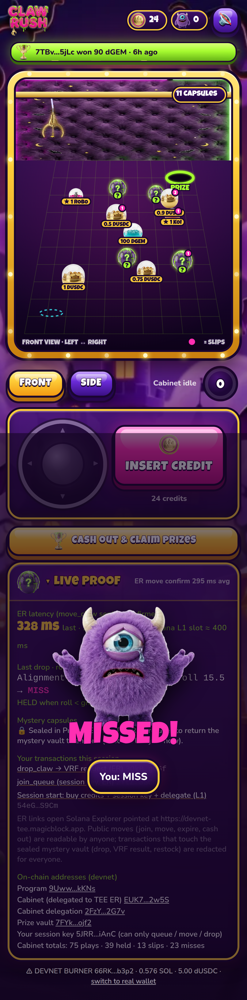
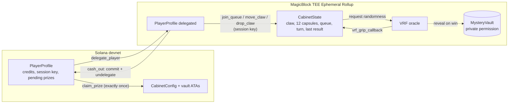
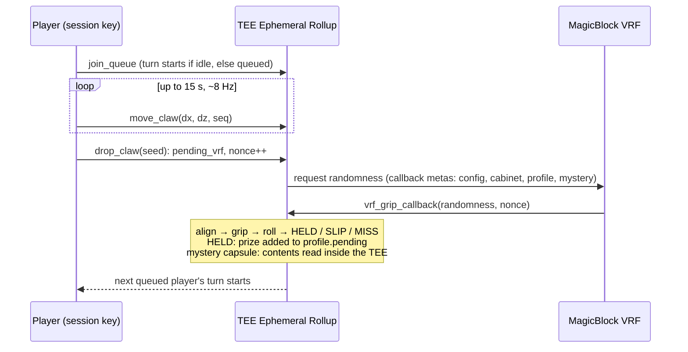

# 🕹️ ClawRush

**One claw, every player, real prizes.**

ClawRush is a live multiplayer claw machine you play from your phone, built on Solana with
[MagicBlock](https://docs.magicblock.gg). Everyone plays the **same cabinet** in real time, capsules
**stay where they land**, your **aim sets your grip chance** before MagicBlock VRF rolls it, and jackpot
**mystery capsules are sealed** inside MagicBlock's TEE-backed Private Ephemeral Rollup so bots can't read
them. Wins settle devnet tokens and collectibles to your wallet on Solana.

Built for **MagicBlock Solana Blitz v10 (Entertainment Finance)**. Everything below runs on **Solana devnet**
and the **MagicBlock devnet TEE validator**. Tokens are demo devnet tokens with no value.

<p align="center">   </p>

## ▶️ Try it

- **Live app:** https://clawrush.pages.dev (phone, portrait)
- **Demo video:** NOT COMPLETED (to be recorded)

1. Connect a devnet wallet (Phantom / Solflare, or Mobile Wallet Adapter on Android). For a quick look, the
   app offers an opt-in, clearly labelled **devnet burner** wallet kept only in your browser. The burner path is
   tested end-to-end in a browser; the Phantom / Solflare / MWA path is built but **not yet tested on a device**.
   You need a little devnet SOL for fees (https://faucet.solana.com; the public airdrop is often rate-limited).
2. **Start session**: one approval buys credits (free demo dUSDC from the faucet in the same transaction),
   registers a scoped session key, and moves your profile onto the Ephemeral Rollup.
3. **Insert credit** to join the shared queue. On your turn (15 s) steer with the joystick, switch
   **FRONT / SIDE** view to judge depth, and **DROP**. No wallet popups while playing.
4. **Cash out**: one approval commits your profile back to Solana and pays every prize to your wallet.

## What you see on the phone

- **A real-time 3D cabinet** (three.js, WebGL). Capsules are placed at their exact on-chain grid
  coordinates and radius (world unit = 100 grid units), so what you aim at is what the program measures.
  Two fixed cameras (FRONT looks along depth, SIDE looks across it); switching glides the camera, and you
  still need both views to judge depth, exactly like the on-chain aim. Slipped capsules visibly slide to their
  new on-chain position; restocked ones pop in. Falls back to a 2D canvas if WebGL is unavailable.
- **Live predicted-grip meter.** While you aim, the app runs the program's own integer math
  (`nearest` → `align_err_bps` → `grip_bps`, ported 1:1 in `app/src/lib/math.ts`, curve read from the on-chain
  `CabinetConfig`) and shows "GRIP 78% · predicted". MagicBlock VRF then rolls against the real number.
- **In-browser fairness re-check.** The Live Proof drawer recomputes every drop's result from the on-chain
  record (alignment → grip curve → roll < grip ⇒ HELD) and shows ✓ when it matches the program.
- **Recent winners** board and win ticker built from the cabinet's on-chain `recent_wins` ring buffer.
- Original 3D-rendered characters and logo (AI-generated, credits in `docs/DECISIONS.md`), frame-swap and
  squash-and-stretch character animation, sound and haptics. All presentation; none of it decides outcomes.

## Why ClawRush

| | Typical on-chain claw (e.g. arclaw) | ClawRush |
|---|---|---|
| Skill matters | No, the claw is "the show", RNG decides | **Aim × VRF grip**: 85% dead centre → 25% at the edge |
| Players per cabinet | One at a time, isolated | **One shared live cabinet**, queue + 15 s turns |
| Persistent state | Fresh box each play | **Capsules stay where they land**; slips move them toward the chute for the next player |
| Hidden prizes | Box contents | **Mystery capsules sealed in a Private ER**, unreadable even to the operator's RPC token |
| Fairness proof | VRF | VRF + live predicted-grip meter + in-browser re-check of every drop + Monte Carlo payout simulation + devnet invariant tests |

## How MagicBlock powers it

Only primitives that are actually integrated and exercised on devnet are listed.

| Primitive | Used for | What breaks without it |
|---|---|---|
| **Ephemeral Rollup** (TEE validator `MTEWGuqx…`, `devnet-tee.magicblock.app`) | The cabinet account and player profiles are delegated; queue, every claw move, drop and turn expiry run there. Move confirmations measured ~380–780 ms from the browser. | L1 is too slow for a joystick, and every move would cost a fee and a wallet popup. |
| **VRF** (`ephemeral_vrf_sdk`, ephemeral queue) | `drop_claw` requests randomness; `vrf_grip_callback` rolls the grip, the slip distance and miss nudges. Callback seen a median 205 ms after the drop confirmed (30 devnet rounds; max 6.5 s on a slow link). | The operator or validator could choose who wins. |
| **Private ER / permission program** | `seal_mystery` puts a private permission with zero members on the mystery vault. The TEE RPC returns `null` for it to everyone and redacts transactions that list it (verified for restock and drop; no readable callback ever appeared either). | Bots read which `?` capsule holds the jackpot and snipe it. |
| **Commit + undelegate + Magic Action** | `cash_out_and_settle` (wallet-signed, on the ER) commits and undelegates the profile and attaches a post-undelegate Magic Action, `settle_prizes`, that pays every pending prize from the vault on L1 in the same settlement. One signature, no second claim transaction. `claim_prize` stays as the fallback if an action is ever dropped; both zero `pending` as they pay, so nothing is paid twice. | Prizes would stay in the rollup, or need a second L1 transaction and wallet popup to reach the wallet. |
| **Crank (ER scheduled task)** | `schedule_crank` registers a task on the TEE ER's scheduler that runs `crank_tick` every 3 s. The tick ends any turn past its deadline and hands the claw to the next player in the queue. No server is involved, and it is idempotent (a no-op unless a turn is overdue). | One idle player would block the shared cabinet until someone ran an off-chain keeper. |

We did **not** use MagicBlock Session Keys: ClawRush registers its own scoped session key in the player profile
(see Security).

Verified on devnet: [`scripts/e2e_magic_action.ts`](scripts/e2e_magic_action.ts) wins a capsule and cashes out with
one ER transaction, then checks that the wallet received exactly the pending amount, that L1 `pending` is zero, that a
later `claim_prize` fails with `NothingToClaim`, and that calling `settle_prizes` directly (without the delegation
program's escrow signature) is rejected. [`scripts/crank.ts`](scripts/crank.ts) schedules the crank and `watch`es
turns clear.

## Architecture





## Grip math (integer only, `programs/clawrush/src/math.rs`)

```
nearest capsule c to the claw (x, z), d = isqrt(dx² + dz²)
align_err_bps = min(10_000, d · 10_000 / c.radius)        ≥ 10_000 → MISS (claw outside the capsule)
grip_bps      = grip_max − (grip_max − grip_min) · align_err_bps / 10_000     85% centre → 25% edge
roll_bps      = u16(randomness[0..2]) % 10_000
roll < grip   → HELD: prize to the player's pending balance, capsule removed
otherwise     → SLIP: capsule moves toward the chute by u16(randomness[2..4]) % 10_000 of the way, slip_count += 1
MISS          → up to 2 nearby capsules nudged by small offsets from randomness[4..8]
```

All of it is bps and integer grid units (0–1000), unit-tested in Rust (`cargo test -p clawrush --lib`, 15 tests),
and ported to TypeScript (`scripts/lib/math.ts`) with the same test vectors.

## Economics and solvency

Monte Carlo over the same integer math (`scripts/ev_simulation.ts`, 100,000 turns per population; full table in
[`scripts/ev_results.md`](scripts/ev_results.md)):

| Player | Return to player | HELD | SLIP | MISS |
|---|---|---|---|---|
| Beginner (random target, sloppy aim) | 33.0% | 36.5% | 38.4% | 25.1% |
| Skilled | 78.0% | 77.7% | 22.3% | 0.0% |
| Perfect aim-bot | 86.2% | 86.3% | 13.7% | 0.0% |

Skill raises returns, but even a perfect bot stays below 100% because visible prizes are capped near one play and
jackpots live only in sealed mystery capsules (mystery EV ≈ 1 play). On chain, `restock` rejects any stock the
vault can't cover (`VaultInsolvent`); in simulation the vault never went below its live liability.

## Security model

- **Session key scope.** `register_session_key` (wallet-signed, L1, ≤ 24 h) stores one key. It is accepted only by
  `join_queue`, `move_claw`, `drop_claw`. Every other instruction derives the profile from the signing wallet.
- **Per-cabinet profiles**: `["player", cabinet_id, wallet]`, so a prize from one cabinet can't be claimed from another
  cabinet's vault.
- **VRF**: only the VRF program identity can sign the callback; `pending_vrf` + a per-drop nonce allow one callback per
  drop; a stuck VRF is cancelled after 30 s by `expire_turn`, which refunds the credit.

The 7 invariants from `docs/03-ARCHITECTURE.md` are tested with **real devnet / TEE transactions** on a separate test
cabinet with a 3 dUSDC vault: [`tests/invariants.ts`](tests/invariants.ts) → [`docs/INVARIANTS.md`](docs/INVARIANTS.md),
**23/23 checks pass**.

| # | Invariant | Tested by (expected rejection) |
|---|---|---|
| 1 | Only the turn owner or their valid session key can move / drop | other player's key → `NotYourTurn`; unregistered key → `SessionKeyNotAllowed`; expired session → `SessionExpired` |
| 2 | Session key can't buy, claim, cash out, restock | `ConstraintSeeds` ×3, `ConstraintHasOne`; session > 24 h → `SessionTooLong` |
| 3 | Only the VRF identity can call the callback; one callback per drop | forged callback → `Unauthorized`; each drop resolved by exactly one callback |
| 4 | `expire_turn` works for anyone after expiry, never before | early → `TurnNotExpired`; after expiry an unrelated key clears it |
| 5 | Restock can't break solvency | over-stock → `VaultInsolvent`; solvent restock accepted |
| 6 | A prize is paid exactly once | claim while delegated → `AccountOwnedByWrongProgram`; first claim pays; second → `NothingToClaim`; cabinet-1 profile on cabinet 2 → `ConstraintSeeds` |
| 7 | Mystery vault unreadable | `getAccountInfo` returns `null` with no token, a stranger's token and the authority's token |

Shared queue behaviour (B queues during A's turn, B's turn starts when A's VRF result lands, timeouts) is tested by
[`scripts/e2e_two_player.ts`](scripts/e2e_two_player.ts) → [`docs/E2E_TWO_PLAYER.md`](docs/E2E_TWO_PLAYER.md), **8/8**.

## On-chain proof (devnet)

| Item | Link |
|---|---|
| Program | [`9UwwBZu55wdbjQm3LdDKLHck79Sr95EPZsS5zRuvkKNs`](https://explorer.solana.com/address/9UwwBZu55wdbjQm3LdDKLHck79Sr95EPZsS5zRuvkKNs?cluster=devnet) · [latest deploy](https://explorer.solana.com/tx/MhDJFzv8Dz9rhgfKMQKFEeRu6WdFiiYwv1Dh8vfrTsfNMrL8Hr43iCo23M8JW8mkQVZhc32XBX7KitYPGb4EqTe?cluster=devnet) |
| Cabinet config (L1) | [`CLaFhSGw…`](https://explorer.solana.com/address/CLaFhSGwWV96RqhR49LoWyxfrJo9e7jQGbeDWTdckWDv?cluster=devnet) · [init_cabinet tx](https://explorer.solana.com/tx/4nAPxqpwKGe27hHYs7qgHnV5Cb4apEjhhFD1K3zsuqLJqbsLurNfjZ7MX31D8PAiysj9gMszQwtGU5PBadF1A7CB?cluster=devnet) |
| Cabinet state (delegated) | [`EUK77P9z…`](https://explorer.solana.com/address/EUK77P9zFtQDdivoMEcktcGfs9wHPdyydbtiG1P62w5S?cluster=custom&customUrl=https%3A%2F%2Fdevnet-tee.magicblock.app) on the TEE ER |
| Delegation to the TEE ER | [delegate_cabinet tx](https://explorer.solana.com/tx/2FzY9oJrQXab58GSnLmjZ6ShPzQnAnvi4zkzxRKjLLSkd4LGGMqU4vX2WctvvKXxmZyXv5dgELXfNk1cHpWN2G7v?cluster=devnet) |
| Prize vault (authority PDA) | [`7FYk2SBg…`](https://explorer.solana.com/address/7FYk2SBgXR3uM7YtdP5Kg9qMF1D1T5zKF8QFGvRMojf2?cluster=devnet) · [dUSDC vault ATA](https://explorer.solana.com/address/8KARifuHeMqHxX3arzsAVbMsbyDfcXNxfhJwg3LdTob6?cluster=devnet) |
| Player session start (buy credits, session key, delegate) | [buy_credits](https://explorer.solana.com/tx/2MWZDtPEuU1xN4YQQSNn7rTVGFDFVxuQaaVfuKniQtC99K4i2Q9hBvrkp5mHtaQ51qWW2MYrirqJtYNaX1AcjxJJ?cluster=devnet) · [register_session_key](https://explorer.solana.com/tx/2XfZwLabdThUYDed5gu8oSkBLYBDsxhD52x7JTq2ze5c8sDwDKCK24rrWkxCd5tun5yFUtJQHCBJr3GvqpFTW9UX?cluster=devnet) · [delegate_player](https://explorer.solana.com/tx/3WZTo93oLX9EkRG9KZgAFrcsgmwbXuU96XVrbJAZ8JQVV198Anq6jEtaoEHH2T77EXQwUw2fvQQtkkn3NpkXMKVB?cluster=devnet) |
| Queue + claw moves on the ER (public) | [join_queue](https://explorer.solana.com/tx/5YVKpXCc7WBBCbv5uZmTRqRBjrmahPtdxkY3aqK8nbKcrHe3Z7BHfvhvXR33MQ1pApQmwgASPZxhVinESN7PsreH?cluster=custom&customUrl=https%3A%2F%2Fdevnet-tee.magicblock.app) · [move_claw](https://explorer.solana.com/tx/5bjqZesyUdyan4CPhKdt9gRFCTb8DbpzTh6bKSNnTpqtREKbcghidCi3rbk3f6yRQdm7TrNBb3tQyze71peA9cQr?cluster=custom&customUrl=https%3A%2F%2Fdevnet-tee.magicblock.app) · [expire_turn](https://explorer.solana.com/tx/4rQf8824sYxLVToTDWvckw9YXY9ZbVxEsWXF8ULEeZ9hhzywtQ7mJSRQeuRSL6zsuofCqVasJSdsMDmH8GD6GKcc?cluster=custom&customUrl=https%3A%2F%2Fdevnet-tee.magicblock.app) |
| VRF request (drop_claw) | [drop_claw](https://explorer.solana.com/tx/2StUx3hxkW25qT8fPCcSZMQqebv43yCbN2kCFoJeFfthEKs76uG1gmeVhPjswsu4PyHp1ruSjzsR3zmP8SaJMA1p?cluster=custom&customUrl=https%3A%2F%2Fdevnet-tee.magicblock.app): **contents redacted by the TEE** (it lists the sealed mystery vault) |
| VRF callback / mystery reveal | NOT COMPLETED as a public link: callback transactions write the sealed vault and never appear readable on the TEE RPC. The result is public in the cabinet account's `last` field (round, align, grip, roll, outcome, prize) and shown in the app's proof drawer. |
| Commit back to Solana (cash_out) | [ER cash_out](https://explorer.solana.com/tx/4YqD5r8d2NEf4vbcjwec5HWrJMXrNqMkoVf9x337Ryd9aDXXeT96KcqZcjaUKh6Qai52syK6mA1mcSTRtiAx17s7?cluster=custom&customUrl=https%3A%2F%2Fdevnet-tee.magicblock.app) → [L1 commit + undelegate](https://explorer.solana.com/tx/4Uhei7iDrD45vqoh3L2JNuCQ2ChrnB137yoy8er1GBYACBNhHRTouFFUJ6Yfg2uchdfWWyx5E1bjBkuy4T3bBeys?cluster=devnet) |
| Prize payout (claim_prize, L1) | [5 dUSDC to playerA](https://explorer.solana.com/tx/5Z7gTStyPDucoquKDvk8qKuHcuFAgTyMgzgWeG6MiR1cxByNCRK5mSWhWaxUEFAqiPz6vu4WqYPF2NfqAARKMVPS?cluster=devnet) after its [L1 commit](https://explorer.solana.com/tx/5SrdtUc7YSbMCXgqeEo5UuhoWnkGs8gfho18WyWoPAnQbHvkahZBmpeSRCMAbyKco43A1xm53A4jkbh3vFaYvpCJ?cluster=devnet); every claim is listed in [`docs/DEVNET_ROUNDS.md`](docs/DEVNET_ROUNDS.md) |
| Real rounds | 34 attempts on the current build: **30 completed** (HELD 17 · SLIP 5 · MISS 8), **4 failed and recorded** (3 × `TurnExpired` when a slow link pushed the drop past 15 s, 1 script crash on a TEE connect timeout). Median VRF callback 205 ms. [`docs/DEVNET_ROUNDS.md`](docs/DEVNET_ROUNDS.md). Plus 34/34 on the earlier build: [`docs/DEVNET_ROUNDS.v1.md`](docs/DEVNET_ROUNDS.v1.md) |

ER transaction links open Solana Explorer pointed at the TEE RPC (`customUrl`). Transactions that only touch public
accounts (join, move, expire, cash out) are fully readable there. Anything touching the sealed vault comes back as an
empty stub, which is the privacy guarantee working (checked with a control tx in
[`scripts/check_tx_privacy.ts`](scripts/check_tx_privacy.ts), decision 14 in [`docs/DECISIONS.md`](docs/DECISIONS.md)).

## On-chain vs client-side

On chain: queue and turns, every claw position, drop, VRF roll, grip/slip/miss resolution, capsule positions and slip
counts, mystery contents and reveal, credits, pending prizes, payouts, solvency checks.

Client-side only: the three.js cabinet (and its 2D fallback), claw sway and drop/lift animation, the predicted-grip
meter and the fairness re-check (both read on-chain numbers and only display them), sounds and haptics, the joystick's
predicted claw position between confirmations (it snaps to chain state), and the devnet burner wallet.

Turn expiry is on chain: the ER crank clears idle turns (the app and `expire_turn` also can, permissionlessly).
Operator process: [`scripts/keeper.ts`](scripts/keeper.ts) only restocks when capsules run low (restock writes the
private vault and seals new mystery contents, so only the cabinet authority can do it). It runs on the operator's
machine, not as a hosted service.

## Run locally

```bash
# program
anchor build
cargo test -p clawrush --lib                     # 15 math unit tests
solana program deploy target/deploy/clawrush.so --program-id <your program keypair> --url devnet

# devnet setup (mints, cabinet, delegation, sealed mystery vault, stock, two test players)
npm install
npx tsx scripts/setup_devnet.ts
npx tsx scripts/lib/math.test.ts                 # TS port matches the Rust vectors
npx tsx scripts/ev_simulation.ts                 # writes scripts/ev_results.md
ROUNDS=32 PLAYERS=playerA,playerB npx tsx scripts/devnet_rounds.ts
npx tsx scripts/e2e_two_player.ts
CABINET_ID=2 SMALL_VAULT=1 npx tsx scripts/setup_devnet.ts && CABINET_ID=2 npx tsx tests/invariants.ts
npx tsx scripts/keeper.ts                         # keep the cabinet stocked

# app
cd app && npm install && npm run dev             # npm run build → static export in app/out
```

Toolchain and every design decision with its trade-off: [`docs/DECISIONS.md`](docs/DECISIONS.md).

## What's next

- Pass the mystery vault to `drop_claw` as a derived address instead of an account, so drop transactions stay public.
- Restock from the crank too (needs the mystery contents sealed by a program-held secret instead of the authority).
- Real collectible NFTs (Metaplex) instead of demo collectible tokens.

## License

MIT
