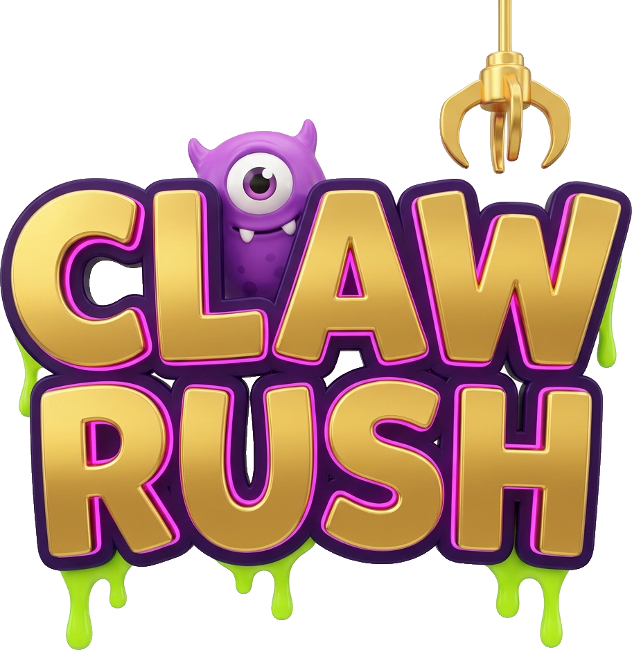
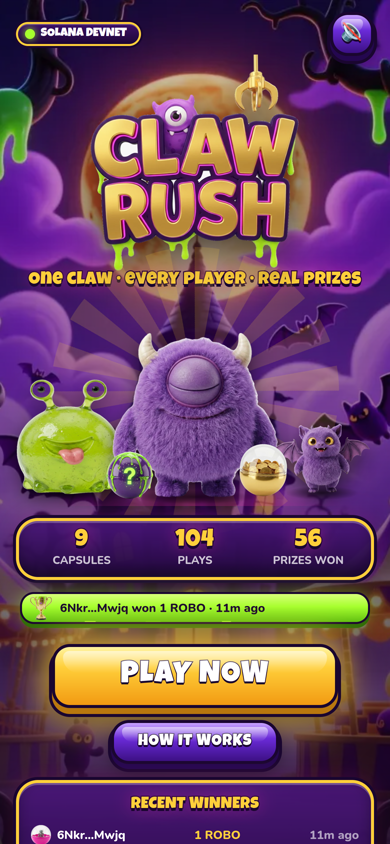
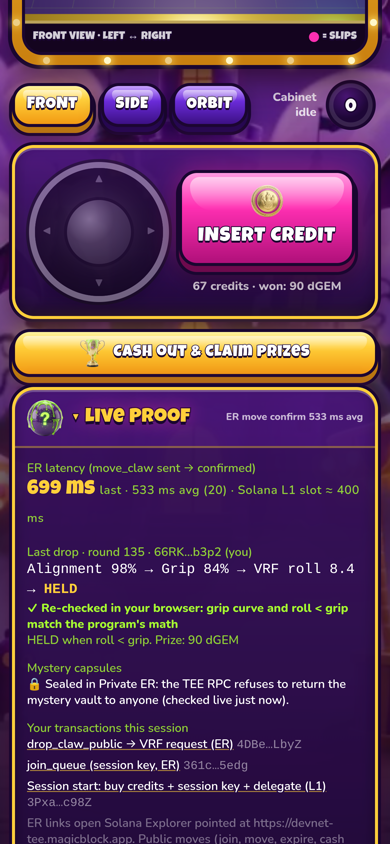
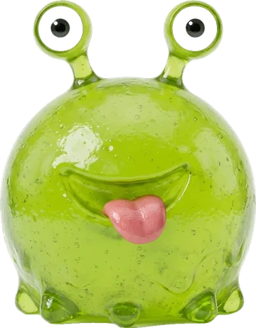
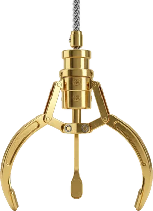
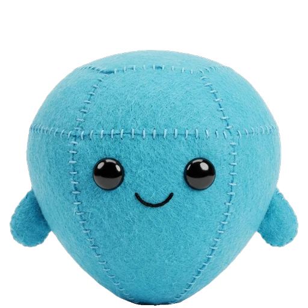
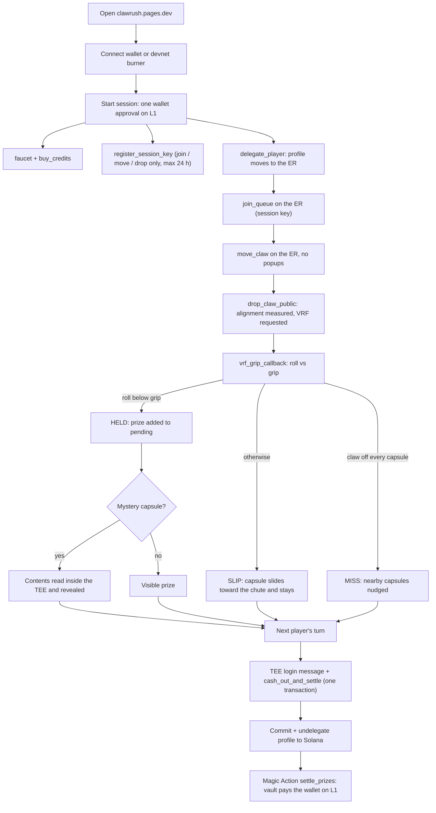
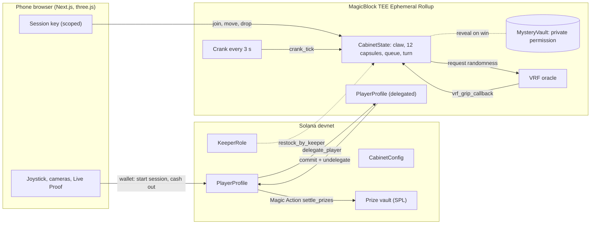

<p align="center">
  
</p>

<h1 align="center">ClawRush</h1>

<p align="center"><b>One claw, every player, real prizes.</b><br>
A live multiplayer claw machine you play from your phone, where your aim sets your odds and MagicBlock VRF rolls them.</p>

<p align="center">
  <a href="LICENSE"></a>
  
  
  
  <a href="https://clawrush.pages.dev"></a>
  <a href="https://github.com/LSUDOKO/ClawRush/actions/workflows/ci.yml"></a>
</p>

ClawRush puts one shared claw cabinet on a MagicBlock Ephemeral Rollup: everyone in the queue plays the same box,
and the capsules stay where the last player left them. Your aim decides your grip chance (85% dead centre, 25% at the
edge) before MagicBlock VRF rolls it, and jackpot mystery capsules are sealed in a Private Ephemeral Rollup so no bot can
read them first. Wins pay devnet tokens and collectibles to your wallet in one cash-out transaction.

Built for **MagicBlock Solana Blitz v10, theme "Entertainment Finance"**, answering MagicBlock's own prompt:
*"An arcade claw you play from your phone, stocked with collectibles and tokens instead of plush toys."*

> Everything runs on **Solana devnet** and the **MagicBlock devnet TEE validator**. Prize tokens are demo tokens with no
> value. Every number and link here comes from a real devnet run; anything partial is labelled in
> [Honest status](#honest-status).

<p align="center">
  
</p>

<a id="play"></a>

## Play it

**Live app: https://clawrush.pages.dev** (phone, portrait)

**Demo video:** TODO (owner adds YouTube link)

| 1. Start a session | 2. Aim and drop | 3. Cash out |
|---|---|---|
| Connect a devnet wallet (or the clearly labelled in-browser devnet burner) and approve once. That one approval buys credits with free demo dUSDC, registers a scoped session key and moves your profile onto the Ephemeral Rollup. | Insert a credit to join the shared queue. On your 15 s turn, steer with the joystick, flip **FRONT / SIDE** to judge depth, then **DROP**. No wallet popups while you play. | Sign one login message for the TEE rollup, then approve one cash-out transaction: it commits your profile back to Solana, and a Magic Action pays every prize you won to your wallet in the same settlement. The first time, a separate transaction creates your prize token accounts. |

You need a little devnet SOL for fees (https://faucet.solana.com); the burner option avoids this for a quick look.

## Screenshots

Taken today from the live site (https://clawrush.pages.dev) at 390×844 by
[`app/e2e/round.mjs`](app/e2e/round.mjs), during a real devnet round: the claw was steered onto the 90 dGEM plush,
the program measured 98% alignment and 84% grip, VRF rolled 8.4%, and the capsule was **HELD**.

<table>
  <tr>
    <td align="center" width="33%"><br><b>Landing</b><br><sub>live cabinet stats</sub></td>
    <td align="center" width="33%"><br><b>Shared cabinet</b><br><sub>everyone plays the same box</sub></td>
    <td align="center" width="33%"><br><b>Aiming</b><br><sub>98% alignment, GRIP 84% predicted</sub></td>
  </tr>
  <tr>
    <td align="center"><br><b>Result</b><br><sub>VRF rolled 8.4%: HELD, 90 dGEM</sub></td>
    <td align="center"><br><b>Live Proof</b><br><sub>re-checks the stored on-chain result</sub></td>
    <td align="center"><br><b>The round, animated</b><br><sub>aim → drop → win</sub></td>
  </tr>
</table>

<sub>The GIF was recorded in headless Chrome with software WebGL, so its frame rate is lower than on a phone. The pause
after the drop is the real wait for the VRF callback plus rendering.</sub>

## Meet the crew

The cast of the cabinet. Every prize you can grab is a plush with its own on-chain token (Metaplex metadata on devnet).

<table>
  <tr>
    <td align="center" width="25%"><br><b>Mascot</b><br><sub>cheers every win</sub></td>
    <td align="center" width="25%"><br><b>Slime</b><br><sub>crew</sub></td>
    <td align="center" width="25%"><br><b>Bat</b><br><sub>crew</sub></td>
    <td align="center" width="25%"><br><b>The Claw</b><br><sub>one claw, every player</sub></td>
  </tr>
  <tr>
    <td align="center"><br><b>Coin</b><br><sub>pays dUSDC</sub></td>
    <td align="center"><br><b>Gem</b><br><sub>pays dGEM</sub></td>
    <td align="center"><br><b>Koi</b><br><sub>KOI collectible</sub></td>
    <td align="center"><br><b>Robo</b><br><sub>ROBO collectible</sub></td>
  </tr>
  <tr>
    <td align="center" colspan="4"><br><b>Mystery capsule</b><br><sub>sealed in the Private ER: nobody can read what is inside until it falls</sub></td>
  </tr>
</table>

Transactions from that round: [session start (L1)](https://explorer.solana.com/tx/3PxazQdMm6PR7hEHPHLadL2DKERGLd6sv8A8TakHjn1Bhsh5PWjfoCrQRRwtpLdoZurBadGc5i7Mkphdw95c98Z?cluster=devnet) ·
[drop → VRF request (ER)](https://explorer.solana.com/tx/4DBe3B4qFtzLuZ8MjnSg2NSmfzLdqskUF7uK1c4jwhDdt4pz67Ayy1wW9hj1DH5hrysuhtsy7JhZRwiecr5cLbyZ?cluster=custom&customUrl=https%3A%2F%2Fdevnet-tee.magicblock.app) ·
[cash out (ER)](https://explorer.solana.com/tx/265JbvUMkmyYW37DuH7Vn3a7mcasfAUzUsARdzfyBDxot1f2E8vgK1td2nJRrEDzjUHPGxvDtm7fLHuPqj526fyb?cluster=custom&customUrl=https%3A%2F%2Fdevnet-tee.magicblock.app) →
[commit + undelegate + settle_prizes (L1), 90 dGEM paid](https://explorer.solana.com/tx/3JQvLZjDfzbnMrWmsz1B7WvQH33d3W2fKamZRQb9SHiewDn685jyhjTr6gg9e4GVQ7itxM2LaKeDNfMCYVfZ3wXD?cluster=devnet).

## The problem

Claw machines are famous for one thing: your skill barely matters.

- Physical cranes let the operator decide how often the claw grips hard. Vox, reading the operator manuals:
  *"the claw machine is programmed to have a strong grip only part of the time"*
  ([Vox, 2015](https://www.vox.com/2015/4/3/8339999/claw-machines-rigged)). Smithsonian: *"Crane games are designed
  not to reward skill, but luck"*, citing a Captain Claw manual whose default gives a strong-enough claw to one in
  every 18 players ([Smithsonian, 2012](https://www.smithsonianmag.com/smart-news/yes-arcade-crane-games-are-rigged-heres-how-26978073/)).
- The on-chain claw game already built on MagicBlock says the same about itself. arclaw's FAQ, answering
  "Is the claw skill-based?": *"No. You steer the claw live, but it is the show. The arclaw program decides the box
  contents with a verifiable random draw from MagicBlock VRF."* ([arclaw.app](https://arclaw.app), FAQ, fetched 27 Nov 2026).

So the steering is decoration either way: hidden operator settings in an arcade, a fixed random draw on chain.
ClawRush makes the claw the game. Where you drop is an input to the odds, the odds formula is public and integer-only,
the roll comes from MagicBlock VRF, and your browser re-checks every stored result (alignment → grip → roll < grip).

## Why ClawRush

Only statements we could check: the arcade column cites the articles above, the arclaw column cites
[arclaw.app](https://arclaw.app) as fetched on 27 Nov 2026, and the ClawRush column points at this repo.

| | Physical arcade crane | arclaw | **ClawRush** |
|---|---|---|---|
| Does aim change the odds? | Grip strength follows an operator payout setting ([Vox](https://www.vox.com/2015/4/3/8339999/claw-machines-rigged)) | "No. You steer the claw live, but it is the show." | **Yes.** Alignment sets grip from 85% to 25%, then VRF rolls it ([`math.rs`](programs/clawrush/src/math.rs)) |
| Where the randomness comes from | The machine's controller | MagicBlock VRF | MagicBlock VRF; only the VRF identity can call back, once per drop |
| Can a play come up empty? | Yes | "Each play gives one sealed box, and there is no miss." | Yes: HELD, SLIP or MISS |
| Prizes | Plush toys | Tokenized stocks; 1 / 5 / 10 USDC per play | Devnet tokens and collectibles (demo, no value); 1 dUSDC per credit |
| Shared, persistent cabinet | n/a | Not stated on its site | One cabinet, shared queue, capsules stay where they land; slips move them toward the chute |
| Hidden jackpots | n/a | Box contents decided by a VRF draw | Mystery capsules sealed in a Private ER; unreadable over RPC until won |
| Published odds / proof | Set inside the machine | Odds table per machine on its site | Formula + Monte Carlo ([`scripts/ev_results.md`](scripts/ev_results.md)) + in-browser re-check of every stored drop result (the VRF callback tx itself is TEE-redacted) |

## Core features

Every MagicBlock primitive here is load-bearing: remove one and a feature breaks.

| Feature | What it does | MagicBlock primitive | What breaks without it |
|---|---|---|---|
| **Shared live cabinet** | One `CabinetState` holds the claw, 12 capsules, a 16-slot queue and the current turn. Every move is a transaction; browser move confirmations measured at ~380–780 ms. | Ephemeral Rollup (TEE validator) | On L1 every joystick tick would cost a fee and a wallet popup, and a 15 s turn would be a few moves. |
| **Skill × VRF grip** | `drop_claw_public` measures your alignment to the nearest capsule and requests randomness; `vrf_grip_callback` rolls grip, slip distance and miss nudges. Median callback 205 ms after the drop over 30 devnet rounds. | VRF | The operator or validator could pick outcomes. |
| **Sealed mystery capsules** | `seal_mystery` puts a zero-member permission on the mystery vault. The TEE RPC returns `null` for it to everyone, including the authority's own token. The callback reads the contents inside the TEE on a win. | Private ER (permission program) | Bots read which `?` capsule holds the jackpot and snipe it. |
| **One-transaction payout** | `cash_out_and_settle` commits and undelegates your profile and attaches a post-undelegate Magic Action, `settle_prizes`, that pays every pending prize from the L1 vault. `claim_prize` stays as a fallback; both zero `pending`. | Commit + undelegate + Magic Action | Prizes stay stuck in the rollup, or need a second transaction and popup. |
| **No stuck turns** | `crank_tick` runs every 3 s on the ER scheduler, ends overdue turns and hands the claw to the next player. No server. | ER crank (scheduled task) | One idle player blocks the shared cabinet. |

Around them, presentation only (none of it decides outcomes): a three.js 3D cabinet with front, side and spectator
orbit cameras (2D canvas fallback), a live **predicted grip** meter that runs the program's own integer math, a
**Live Proof** drawer that re-checks alignment → grip → roll < grip from the result stored on chain (a third party sees the stored roll, not the VRF proof: the callback tx lists the private vault, so the TEE hides it), a win ticker from the cabinet's
`recent_wins` ring buffer, sound and haptics.

## End-to-end workflow



## Architecture

Full design, endpoints, SDK versions and every instruction: [`ARCHITECTURE.md`](ARCHITECTURE.md). Judge walkthrough: [`JUDGES.md`](JUDGES.md). Business model: [`BUSINESS.md`](BUSINESS.md). No Magic Router and no MagicBlock Session Keys program: the app connects straight to the TEE ER and the session key is our own, scoped in the program. Trade-offs:
[`docs/DECISIONS.md`](docs/DECISIONS.md).



<details>
<summary>Accounts (from <code>programs/clawrush/src/state.rs</code>)</summary>

| Account | Seeds | Lives on | Holds |
|---|---|---|---|
| `CabinetConfig` | `["config", cabinet_id]` | L1 | authority, play price, turn length, grip max / min bps, per-round payout caps, 4 prize mints, total claimed |
| Prize vault | `["vault", cabinet_id]` | L1 | PDA that owns the prize token accounts |
| `CabinetState` | `["cabinet", cabinet_id]` | ER, public | claw x / z, 12 capsules, 16-slot queue, turn owner and expiry, VRF nonce, last result, recent wins, counters |
| `MysteryVault` | `["mystery", cabinet_id]` | ER, private permission | sealed flag, one hidden `MysteryEntry { set, mint_idx, amount, tier }` per capsule slot |
| `PlayerProfile` | `["player", cabinet_id, wallet]` | L1, delegated to the ER while playing | credits, plays, wins, session key + expiry, pending prizes per mint |
| `KeeperRole` | `["keeper", cabinet_id]` | L1 | the low-privilege key allowed to restock |
| Faucet | `["faucet"]` | L1 | mint authority of demo dUSDC, rate-limited per profile |

</details>

<details>
<summary>Instructions</summary>

| Instruction | Runs on | Signer | Does |
|---|---|---|---|
| `init_cabinet`, `delegate_cabinet`, `seal_mystery` | L1 / ER | authority | Create the cabinet, delegate it and the mystery vault to the TEE ER, seal the vault |
| `restock`, `restock_by_keeper`, `set_keeper` | ER / L1 | authority or keeper | Fill free slots under bounds, payout caps and per-mint solvency |
| `init_player`, `faucet`, `buy_credits`, `register_session_key`, `delegate_player` | L1 | player | Session start (one approval) |
| `join_queue`, `move_claw`, `drop_claw_public` | ER | player or session key | Play a turn |
| `vrf_grip_callback` | ER | VRF identity only | Resolve HELD / SLIP / MISS, reveal mystery on win, start the next turn |
| `expire_turn`, `crank_tick` | ER | anyone / ER scheduler | End overdue turns; refund if the VRF is stuck over 30 s |
| `cash_out_and_settle` → `settle_prizes` | ER → L1 | player → delegation program escrow | One-transaction payout |
| `cash_out`, `claim_prize` | ER, L1 | player | Fallback payout, one mint at a time |

</details>

## Grip math and economics

Integer only, in [`programs/clawrush/src/math.rs`](programs/clawrush/src/math.rs), ported 1:1 to
TypeScript ([`scripts/lib/math.ts`](scripts/lib/math.ts)) and checked against the same test vectors:

```
c  = nearest active capsule to the claw (x, z);  d = isqrt(dx² + dz²)      grid units 0..1000
align_err_bps = min(10_000, d * 10_000 / c.radius)        >= 10_000  -> MISS
grip_bps      = grip_max - (grip_max - grip_min) * align_err_bps / 10_000   8_500 centre -> 2_500 edge
roll_bps      = u16_le(randomness[0..2]) % 10_000
roll < grip   -> HELD: prize added to pending, capsule removed
otherwise     -> SLIP: capsule moves toward the chute by 1_500 + u16_le(randomness[2..4]) % 5_000 bps
                       of the way (15%..65%) and stays there for the next player
MISS          -> up to 2 capsules within 1.5 x radius nudged by up to 40 units from randomness[4..8]
```

Monte Carlo over the same integer math, 100,000 turns per population on a shared cabinet
([`scripts/ev_simulation.ts`](scripts/ev_simulation.ts), real output in [`scripts/ev_results.md`](scripts/ev_results.md)):

| Player | Return to player | HELD | SLIP | MISS |
|---|---|---|---|---|
| Beginner (random target, sloppy aim) | 33.0% | 36.5% | 38.4% | 25.1% |
| Skilled | 78.0% | 77.7% | 22.3% | 0.0% |
| Perfect aim-bot | 86.2% | 86.3% | 13.7% | 0.0% |
| Mixed population (2 beginner : 1 skilled : 1 perfect), house payout | 57.9% | | | |

Skill clearly pays, yet even a perfect bot returns under 100%: visible prizes are capped near one play and jackpots
live only in sealed mystery capsules. In every population the vault never fell below its live liability (minimum
headroom 290.55 plays on a 300-play start). On chain, a restock that the vault can't cover is rejected with
`VaultInsolvent`. Design notes: [`docs/04-ECONOMICS.md`](docs/04-ECONOMICS.md).

<a id="security-model"></a>

## Security

Full threat model and review: [`SECURITY.md`](SECURITY.md). In short:

- **Scoped session key.** `register_session_key` (wallet-signed, at most 24 h) stores one key that only `join_queue`,
  `move_claw` and `drop_claw` / `drop_claw_public` accept. Buying, cashing out, claiming and admin derive the profile
  from the signing wallet, so a leaked session key can't move funds. `expire_turn` and `crank_tick` accept any signer
  by design: anyone may clear an overdue turn, and they can do nothing else.
- **Site headers**: the app sends `X-Frame-Options` and `X-Content-Type-Options: nosniff`.
- **Per-cabinet profiles** (`["player", cabinet_id, wallet]`): a prize from one cabinet can't be claimed from another
  (a real bug found and fixed during the build, with a regression test).
- **VRF**: only the VRF program identity can sign the callback; `pending_vrf` plus a per-drop nonce allow exactly one
  callback per drop; a stuck drop can be cancelled after 30 s with the credit refunded.
- **Magic Action**: `settle_prizes` requires the delegation program's escrow signature, so nobody can call it directly.
- **Keeper role**: restock only, under the same bounds and solvency checks; it never holds the cabinet authority
  (which is also the upgrade key).
- **Open findings** from the review are listed in [`SECURITY.md`](SECURITY.md#7-findings), including a Medium
  VRF-queue stall (F-01, **fixed**: program upgraded on 27 Nov 2026, drops now accept only the ER VRF queue) and the Sybil-able devnet faucet (F-03, accepted for a demo-token
  devnet build, must go before any real-value deployment).

Seven invariants run as **real devnet / TEE transactions** on a separate test cabinet
([`tests/invariants.ts`](tests/invariants.ts) → [`docs/INVARIANTS.md`](docs/INVARIANTS.md), **23/23 checks passed**,
re-run on 27 Nov 2026). More devnet suites (12 extra invariant checks, a two-player slip-then-win with exact
balances) and the Rust math tests are listed with their results in [`TESTING.md`](TESTING.md):

| # | Invariant | Checked by (expected rejection) |
|---|---|---|
| 1 | Only the turn owner or their session key can move / drop | `NotYourTurn`, `SessionKeyNotAllowed`, `SessionExpired` |
| 2 | A session key can't buy, claim, cash out or restock | `ConstraintSeeds` ×3, `ConstraintHasOne`; > 24 h → `SessionTooLong` |
| 3 | Only the VRF identity can call back; one callback per drop | forged callback → `Unauthorized` |
| 4 | `expire_turn` works for anyone after expiry, never before | `TurnNotExpired` |
| 5 | Restock can't break solvency | `VaultInsolvent` |
| 6 | A prize is paid exactly once | claim while delegated rejected; second claim → `NothingToClaim`; cross-cabinet → `ConstraintSeeds` |
| 7 | Mystery vault unreadable | `getAccountInfo` → `null` with no token, a stranger's token and the authority's token |

## On-chain proof (devnet)

Program `9UwwBZu55wdbjQm3LdDKLHck79Sr95EPZsS5zRuvkKNs`. ER links open Solana Explorer pointed at the TEE RPC.
Every L1 signature below returned `finalized` with no error from `getSignatureStatuses` on devnet, and every ER
signature returned `finalized` from `https://devnet-tee.magicblock.app`, checked on 27 Nov 2026.

| Item | Link |
|---|---|
| Program | [`9UwwBZu5…`](https://explorer.solana.com/address/9UwwBZu55wdbjQm3LdDKLHck79Sr95EPZsS5zRuvkKNs?cluster=devnet) · [latest upgrade (F-01 fix, 27 Nov 2026)](https://explorer.solana.com/tx/2vHp9HK6hrro5BADAoqqfBeKJdhg49sh2qPKMffqM2vuoNwBES11u9ybghdgsNk1FCgqDr6G9LtihPjnJ2RiMhTU?cluster=devnet) · [previous upgrade](https://explorer.solana.com/tx/54X1UbEgZ5N8PgFbvGtXULtA9URK4NhUk6kvyHn4JXATLTNvaCkGEFWu2kvYPSBmGWGDokW1fuURBi89u2eB9buw?cluster=devnet) · [first drop after it, HELD in 345 ms (ER)](https://explorer.solana.com/tx/2qo86FM1ZUbWrpEmMkYp7mUmLXnXmG5zrTDpdD9JTLoH2FQe9ChrFgu5pUwjabhkmqpx1jhqJXuorRK59W2demgM?cluster=custom&customUrl=https%3A%2F%2Fdevnet-tee.magicblock.app) |
| Cabinet config (L1) | [`CLaFhSGw…`](https://explorer.solana.com/address/CLaFhSGwWV96RqhR49LoWyxfrJo9e7jQGbeDWTdckWDv?cluster=devnet) · [init_cabinet](https://explorer.solana.com/tx/4nAPxqpwKGe27hHYs7qgHnV5Cb4apEjhhFD1K3zsuqLJqbsLurNfjZ7MX31D8PAiysj9gMszQwtGU5PBadF1A7CB?cluster=devnet) |
| Cabinet state (TEE ER) | [`EUK77P9z…`](https://explorer.solana.com/address/EUK77P9zFtQDdivoMEcktcGfs9wHPdyydbtiG1P62w5S?cluster=custom&customUrl=https%3A%2F%2Fdevnet-tee.magicblock.app) · [delegate_cabinet](https://explorer.solana.com/tx/2FzY9oJrQXab58GSnLmjZ6ShPzQnAnvi4zkzxRKjLLSkd4LGGMqU4vX2WctvvKXxmZyXv5dgELXfNk1cHpWN2G7v?cluster=devnet) |
| Prize vault | [`7FYk2SBg…`](https://explorer.solana.com/address/7FYk2SBgXR3uM7YtdP5Kg9qMF1D1T5zKF8QFGvRMojf2?cluster=devnet) |
| **Phone gameplay** (Chrome on Android, devnet burner) | [ER drop, fee 0, signed by the session key](https://explorer.solana.com/tx/35o1tkTR8FCv84F1x9caoWZFupWewuZzEpyzcFKhYopAC3jinANt94GWm7iXoT332CFTZYDcejgtVa8uUtnWcgJB?cluster=custom&customUrl=https%3A%2F%2Fdevnet-tee.magicblock.app) → [L1 commit + undelegate + settle_prizes](https://explorer.solana.com/tx/5uehoYGrCnNN6obWDi7jrcYunLKzaXwwUDp2KWLE8yxP27LemTe2kDECePG8vn2iVGNpkwnavbe47bhJQfvFM4Vg?cluster=devnet): a mystery capsule (0.35 dUSDC), 75 dGEM and 0.75 dUSDC won on the phone and paid in one settlement |
| Browser round today (screenshots above) | [session start](https://explorer.solana.com/tx/3PxazQdMm6PR7hEHPHLadL2DKERGLd6sv8A8TakHjn1Bhsh5PWjfoCrQRRwtpLdoZurBadGc5i7Mkphdw95c98Z?cluster=devnet) · [drop_claw_public (ER)](https://explorer.solana.com/tx/4DBe3B4qFtzLuZ8MjnSg2NSmfzLdqskUF7uK1c4jwhDdt4pz67Ayy1wW9hj1DH5hrysuhtsy7JhZRwiecr5cLbyZ?cluster=custom&customUrl=https%3A%2F%2Fdevnet-tee.magicblock.app) · [expire_turn (ER)](https://explorer.solana.com/tx/35BzTWg8gMmPa2usEDKFKB8w3odPHVx9n7rAfJ26fD4V5VubGhPbcHdkGAYq6Vs7ug9euyBNRsBv6o3q2Q3hnPJA?cluster=custom&customUrl=https%3A%2F%2Fdevnet-tee.magicblock.app) · [settle 90 dGEM (L1)](https://explorer.solana.com/tx/3JQvLZjDfzbnMrWmsz1B7WvQH33d3W2fKamZRQb9SHiewDn685jyhjTr6gg9e4GVQ7itxM2LaKeDNfMCYVfZ3wXD?cluster=devnet) |
| Session start | [buy_credits](https://explorer.solana.com/tx/2MWZDtPEuU1xN4YQQSNn7rTVGFDFVxuQaaVfuKniQtC99K4i2Q9hBvrkp5mHtaQ51qWW2MYrirqJtYNaX1AcjxJJ?cluster=devnet) · [register_session_key](https://explorer.solana.com/tx/2XfZwLabdThUYDed5gu8oSkBLYBDsxhD52x7JTq2ze5c8sDwDKCK24rrWkxCd5tun5yFUtJQHCBJr3GvqpFTW9UX?cluster=devnet) · [delegate_player](https://explorer.solana.com/tx/3WZTo93oLX9EkRG9KZgAFrcsgmwbXuU96XVrbJAZ8JQVV198Anq6jEtaoEHH2T77EXQwUw2fvQQtkkn3NpkXMKVB?cluster=devnet) |
| Queue + moves (ER) | [join_queue](https://explorer.solana.com/tx/5YVKpXCc7WBBCbv5uZmTRqRBjrmahPtdxkY3aqK8nbKcrHe3Z7BHfvhvXR33MQ1pApQmwgASPZxhVinESN7PsreH?cluster=custom&customUrl=https%3A%2F%2Fdevnet-tee.magicblock.app) · [move_claw](https://explorer.solana.com/tx/5bjqZesyUdyan4CPhKdt9gRFCTb8DbpzTh6bKSNnTpqtREKbcghidCi3rbk3f6yRQdm7TrNBb3tQyze71peA9cQr?cluster=custom&customUrl=https%3A%2F%2Fdevnet-tee.magicblock.app) |
| Public drop → VRF request (ER) | [drop_claw_public](https://explorer.solana.com/tx/mgkuyDCPb4k85BBQ1xwRgSaETtoVZGEQZzLhJJtFLZpUCZPRiCid2K1UmJRSTELdmMetTt7xCDNu1qi8nmR5fdj?cluster=custom&customUrl=https%3A%2F%2Fdevnet-tee.magicblock.app), readable with no token |
| VRF callback / mystery reveal | No public link by design: callbacks write the sealed vault, so the TEE redacts them. The result is public in the cabinet's `last` field and in the app's Live Proof drawer. |
| Crank clearing an idle turn (ER) | [crank_tick](https://explorer.solana.com/tx/31BH7Arp96NU5xS8BDrEhzrxeYHA8Bza3bRhmjCq3Jj5cHqQHZEQ8eR87ML44WdRbuYnsJAjEYQn8Wk4Lks289FK?cluster=custom&customUrl=https%3A%2F%2Fdevnet-tee.magicblock.app), cleared 15.5 s after the turn went idle, keeper stopped |
| Keeper-role restock (ER) | [restock_by_keeper](https://explorer.solana.com/tx/QSiZBRBVxfoBgYChB9vQJCL29qhD1gxVoSWaoiwcARNR2Qawbu1dSJfwnwmEShoNWraSUz5XXuv4G1V27dwgzYA?cluster=custom&customUrl=https%3A%2F%2Fdevnet-tee.magicblock.app) |
| One-transaction payout (Magic Action) | [ER cash_out_and_settle](https://explorer.solana.com/tx/2jV7rciHueZMu2kuSbqxZfWmvjiaonvJ1xMgDb1UqDsFuAMajBLzXfvi1JQJGQdecZGPctTmrxtWxopkrv1JMc6B?cluster=custom&customUrl=https%3A%2F%2Fdevnet-tee.magicblock.app) → [L1 commit + undelegate + settle_prizes](https://explorer.solana.com/tx/31j7usJPvqmit6iJB7a43HMTnfVZvoC7YjKrdYcBE4QumEBR1KHNCFjDd3WtboAo8qqhKXCUPpxQQUixXQRyBxea?cluster=devnet), 1 dUSDC win paid |
| Commit back to Solana (earlier build) | [ER cash_out](https://explorer.solana.com/tx/4YqD5r8d2NEf4vbcjwec5HWrJMXrNqMkoVf9x337Ryd9aDXXeT96KcqZcjaUKh6Qai52syK6mA1mcSTRtiAx17s7?cluster=custom&customUrl=https%3A%2F%2Fdevnet-tee.magicblock.app) → [L1 commit + undelegate](https://explorer.solana.com/tx/4Uhei7iDrD45vqoh3L2JNuCQ2ChrnB137yoy8er1GBYACBNhHRTouFFUJ6Yfg2uchdfWWyx5E1bjBkuy4T3bBeys?cluster=devnet) |
| Prize payout (fallback claim) | [5 dUSDC to a player](https://explorer.solana.com/tx/5Z7gTStyPDucoquKDvk8qKuHcuFAgTyMgzgWeG6MiR1cxByNCRK5mSWhWaxUEFAqiPz6vu4WqYPF2NfqAARKMVPS?cluster=devnet); every claim in [`docs/DEVNET_ROUNDS.md`](docs/DEVNET_ROUNDS.md) |
| Metaplex Token Metadata | [dGEM](https://explorer.solana.com/tx/45VpQq6cqM25xbyLxWmHtkkVBc3P2W5qh7ft5rzGkoLF76QpRrjDM1pHPk7uA4rLeoy2nxfoJhNryam2WxqeGY8g?cluster=devnet) · [KOI](https://explorer.solana.com/tx/bCWqCStTSpUMpVQZdE7MCw6NiPMzc97Kmoxm7ZXaMxkCYRvA1WTMCMMeU8XzPbRqPnjSxCdKLP96AeLx8cw7Bmr?cluster=devnet) · [ROBO](https://explorer.solana.com/tx/5xuaQGX6pdphrVicPyaLMsfzrjcZm2dQJ7utgnwEuvR5sWAegoVjS6fyGpgemSXV8xgvz5JMmQ9t5u29Xk22SGCQ?cluster=devnet) |
| Real rounds | 34 attempts on the measured build: **30 completed** (HELD 17 · SLIP 5 · MISS 8), **4 failed and recorded** (3 × `TurnExpired` on a slow link, 1 TEE connect timeout): [`docs/DEVNET_ROUNDS.md`](docs/DEVNET_ROUNDS.md) |
| Two players, one cabinet | Scripted queue hand-off, 8/8 checks: [`docs/E2E_TWO_PLAYER.md`](docs/E2E_TWO_PLAYER.md). Also a live run today (browser and phone at once; browser won 0.5 dUSDC, phone won 1 ROBO, the crank cleared an idle turn in 15.7 s), browser player's txs: [drop_claw_public](https://explorer.solana.com/tx/4L2a1wuk2TZJKse8h2gb3FUu1tjhBcyviWRm34DHHkNN1gHDsi3pbE9YxC4ptrw3ePBXqFU66CsszBenc5UURJDP?cluster=custom&customUrl=https%3A%2F%2Fdevnet-tee.magicblock.app) · [expire_turn](https://explorer.solana.com/tx/4ZfxMwrRswuyCUS6JfNLuEUM3oHni6W1SF4kdyTEDKT5SkCXTBAfaUZB6SD4SUSgJiC5oRbYCBYUzYACEmiGq2Qe?cluster=custom&customUrl=https%3A%2F%2Fdevnet-tee.magicblock.app) · [L1 settle](https://explorer.solana.com/tx/44cc3yGwbvqHNBzqQWyeg13qNDLywTse58aoB5uMcfDeYF8jPSAEcJxZaJNfpM119dz2Bt2dZPzmePTJq4Pitf8S?cluster=devnet); the phone's side is in the video. |

KOI and ROBO have 0 decimals, so Token Metadata classes them as `FungibleAsset` collectibles, not 1-of-1 NFTs.
dUSDC has no metadata: its mint authority is the faucet PDA.

## Run it locally

Toolchain: Rust + Anchor 1.0.2, Solana CLI, Node 22. If Node fetch times out, set
`NODE_OPTIONS=--dns-result-order=ipv4first`. Full guides: [`TESTING.md`](TESTING.md) and [`DEPLOYMENT.md`](DEPLOYMENT.md).

```bash
# app against the live devnet cabinet
cd app && npm install && npm run dev          # npm run build -> static export in app/out

# program + devnet setup (your own cabinet)
anchor build
solana program deploy target/deploy/clawrush.so --program-id <your program keypair> --url devnet
npm install
npx tsx scripts/setup_devnet.ts               # mints, cabinet, delegation, sealed vault, stock
npx tsx scripts/crank.ts schedule             # schedule the turn-expiry crank (default subcommand is a single tick)
npx tsx scripts/set_keeper.ts <keeper pubkey> # low-privilege restock key
```

| Variable | Default | Used by |
|---|---|---|
| `NEXT_PUBLIC_BASE_URL` | `https://api.devnet.solana.com` | app: Solana RPC |
| `NEXT_PUBLIC_ER_URL` | `https://devnet-tee.magicblock.app` | app: TEE Ephemeral Rollup RPC |
| `BASE_URL`, `ER_URL` | same as above | scripts |
| `ER_VALIDATOR` | `MTEWGuqxUpYZGFJQcp8tLN7x5v9BSeoFHYWQQ3n3xzo` | scripts: TEE validator to delegate to |
| `CABINET_ID` | `1` | scripts and tests (`2` is the test cabinet) |

<details>
<summary>Tests and proofs</summary>

```bash
cargo test -p clawrush --lib                  # grip / slip / miss math unit tests
npx tsx scripts/lib/math.test.ts              # TS port matches the Rust vectors
npx tsx scripts/ev_simulation.ts              # writes scripts/ev_results.md
CABINET_ID=2 npx tsx tests/invariants.ts      # 7 invariants as real devnet transactions
npx tsx scripts/e2e_two_player.ts             # shared queue (stop the keeper first)
npx tsx scripts/e2e_magic_action.ts           # one-transaction payout
CABINET_ID=1 npx tsx scripts/e2e_public_drop.ts
ROUNDS=32 PLAYERS=playerA,playerB npx tsx scripts/devnet_rounds.ts
cd app && AIM=1 URL=https://clawrush.pages.dev KEY=../keys/webtest.json OUT=<dir> node e2e/round.mjs
```

</details>

Deploy the app: `cd app && npm run build && npx wrangler pages deploy out --project-name clawrush --branch main`.
A [GitHub Actions keeper](.github/workflows/keeper.yml) can run one restock pass every 10 minutes once a
`KEEPER_KEYPAIR` secret is set.

## Roadmap

Next steps and their reasoning: [`ROADMAP.md`](ROADMAP.md). Headlines: let Solflare mobile cash out (a wallet-signed
message instead of a wallet-signed ER transaction), restock from the crank with a program-held secret, 1-of-1 Metaplex
Core collectibles minted on win, and more cabinets with different prize pools.

## License

[Apache-2.0](LICENSE)

## Acknowledgements

- [MagicBlock](https://www.magicblock.xyz) for Ephemeral Rollups, the TEE validator, VRF, Magic Actions and the
  Solana Blitz hackathon.
- [Solana](https://solana.com) and [Anchor](https://www.anchor-lang.com).
- [Metaplex](https://www.metaplex.com) Token Metadata for the prize mints.
- [three.js](https://threejs.org) for the cabinet, [Next.js](https://nextjs.org) and
  [Cloudflare Pages](https://pages.cloudflare.com) for the app.

## Honest status

| | Status |
|---|---|
| **On chain** | Queue and turns, every claw position, drop, VRF roll, HELD / SLIP / MISS, capsule positions and slip counts, mystery contents and reveal, credits, pending prizes, payouts, solvency checks, turn expiry (crank). |
| **Client side only** | The 3D cabinet and 2D fallback, the claw's sway and drop animation (cosmetic; the outcome comes from the chain), the predicted-grip meter and Live Proof re-check (they only display on-chain numbers), sound and haptics, the joystick's predicted position between confirmations (it snaps to chain state), and the devnet burner wallet. |
| **Fallbacks** | `claim_prize` per mint if the Magic Action payout is unavailable; the app sends `expire_turn` itself if the crank is late; a stuck VRF drop is refundable after 30 s; 2D canvas when WebGL is missing. |
| **Wallets tested on a phone** | Devnet burner in Chrome on Android: full loop including cash out. Solflare mobile: connect, start session and play work. **Known limitation:** Solflare mobile refuses to sign the cash-out, because that transaction goes to the Ephemeral Rollup and carries an ER blockhash it reports as "network mismatch". Use the burner to see the payout; a Solflare profile from that attempt stays delegated (demo tokens only). Phantom, Mobile Wallet Adapter and desktop wallet extensions are built but not yet tested for cash out. |
| **Privacy trade-off** | VRF callbacks and older-style drops touch the sealed vault, so the TEE redacts them for everyone; outcomes are public through the cabinet account instead. `admin_undelegate` is an emergency path that would make unrevealed mystery contents public. |
| **Operations** | Restock writes the private vault, so it runs from an operator or keeper key, not the crank. Without a keeper the cabinet stops restocking (turns still clear). |
| **Network** | Devnet only. Prize tokens are demo tokens with no value. |
